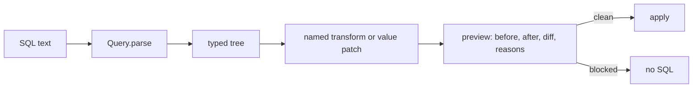

# EdgeSQL

EdgeSQL changes SQL on a typed tree. It reads a statement, resolves every
column, and edits a copy of the tree. It prints the result in the same dialect.
It does not use string replacement.

Supported dialects are `postgres` and `databricks`.

```python
from edgesql import Query

query = Query.parse("SELECT cust_id FROM sales.orders WHERE cust_id = 42", dialect="postgres")
print(query.to_sql())
# SELECT cust_id FROM sales.orders WHERE cust_id = 42
```

## Install

```bash
pip install edgesql
```

From the repository, for development:

```bash
python3 -m venv .venv
.venv/bin/pip install -e ".[dev]"
```

To add the optional Postgres check with `pglast`:

```bash
pip install "edgesql[postgres]"
```

## The two ways to change a query

A `Query` is immutable. Each method returns a new `Query` and leaves the
original unchanged.

1. Lane B: a named transform returns a new `Query`. Preview it, then apply it.
2. Lane A: a value patch replaces one comparison value, range, list, or limit.

Both lanes pass through `preview()`. Apply is the only commit.



## Read a statement

```python
query = Query.parse(sql, dialect="postgres")

query.tables()  # ['sales.orders', 'sales.customers']
query.ctes()  # ['paid']
query.columns()  # ColumnRef objects with table, name, and hop list
query.filters()  # one Filter per conjunct
query.params()  # marker names, for example '1' or 'fare_parameter'
query.to_tree()  # the product IR, schemaVersion '0.1'
```

`filters()` returns one item per conjunct. An `OR` group is one item. Each
item reports its `scope`, `clause`, `op`, `values`, and the columns it touches.
The hop list records the CTEs and derived tables on the path to the physical
table.

## Rename a column with preview and apply

```python
query = Query.parse(
    "SELECT cust_id, status FROM sales.orders",
    dialect="postgres",
)

preview = query.preview(lambda item: item.rename_column("cust_id", "customer_id", table="sales.orders"))

if preview.blocked:
    print(preview.blocked_reasons)
else:
    applied = preview.apply(actor="builder")
    print(applied.to_sql())
    # SELECT customer_id AS cust_id, status FROM sales.orders
```

The output name stays `cust_id`. Set `keep_output_names=False` to change it.

`preview()` computes these fields:

| Field | Meaning |
| --- | --- |
| `before_sql` | Pretty SQL of the original |
| `after_sql` | Pretty SQL of the result |
| `ast_diff` | Edit script from `sqlglot.diff` |
| `semantic_diff` | Tables, filters, joins, projection, and limit |
| `blocked_reasons` | Empty when the preview is clean |
| `collapsed` | True when the pretty SQL did not change |
| `fingerprint` | First 16 hex characters of SHA-256 of canonical SQL |

`apply()` raises `BLOCKED` when the preview is blocked. A second apply of the
same preview returns the same fingerprint.

## Patch one value

A value patch needs a node id from `to_tree()`. It replaces the right-hand
value only.

```python
query = Query.parse(
    "SELECT cust_id, status FROM sales.orders WHERE cust_id = 42 AND status = 'paid'",
    dialect="postgres",
)

patched = query.set_params([{"op": "set_comparison", "nodeId": "n_cmp_cust_eq", "params": {"value": 99}}])
preview = query.preview(lambda _item: patched)
applied = preview.apply(actor="reader")
```

The allowed operations are `set_comparison`, `set_between`, `set_in_list`, and
`set_limit`. A patch that sends `left`, `op`, `column`, or `children` raises
`STRUCTURE_PATCH`.

A comparison is editable only when its right side is a literal, a boolean, a
`NULL`, a negative number, or a parameter marker. A comparison against another
column or a function is read-only, because a value patch would change the
meaning.

## Edit a filter in place

```python
from edgesql import col

query = Query.parse(sql, dialect="postgres")
wider = query.cte("paid").and_where(col("region").eq("EU"))

status = query.filters().where(column="status")[0]
without = query.remove_filter(status)
```

## Build a query

```python
from edgesql import col, param, select

query = select("sales.orders").where(col("status").eq("paid")).where(col("amount").gt(param("floor"))).limit(100)
print(query.to_sql("postgres"))
print(query.to_sql("databricks"))
```

A built query has no parse dialect, so both dialects are available. A parsed
query keeps its dialect. `to_sql` with another dialect raises `CROSS_DIALECT`.

## Dialect rules

| Topic | Rule |
| --- | --- |
| Dialect | `postgres` or `databricks`, always explicit |
| Markers | Postgres prints `$1`; Databricks keeps `:name` and `?` |
| QUALIFY | Databricks only |
| SEMI and ANTI joins | Databricks only |
| DISTINCT ON and FETCH | Postgres only, and `FETCH` refuses on Databricks |
| Recursive CTE | `UNION ALL` on Databricks; `MAX RECURSION LEVEL` is preserved |
| Root statement | `SELECT` and `WITH` only |
| Mixed markers | `:name` with `?` in one Databricks statement raises `MIXED_MARKERS` |

## Errors

Every error carries a phase, a code, an optional hint, and a 12 character
track id. The display text is `[phase/code] message`, plus `Hint: ` when a hint
exists.

| Phase | Codes |
| --- | --- |
| parse | `UNKNOWN_DIALECT`, `EMPTY_SQL`, `PARSE_FAILED`, `MULTI_STATEMENT`, `UNSUPPORTED_STATEMENT`, `DIALECT_NODE`, `MIXED_MARKERS` |
| resolve | `AMBIGUOUS_COLUMN`, `UNKNOWN_SOURCE`, `UNKNOWN_COLUMN` |
| transform | `UNKNOWN_SCOPE`, `UNSUPPORTED_REMOVE`, `UNSUPPORTED_NODE`, `DUPLICATE_CTE`, `CTE_IN_USE`, `RECURSIVE_PROJECTION`, `STRUCTURE_PATCH`, `UNKNOWN_NODE`, `NOT_IN_V1` |
| preview and apply | `BLOCKED` |
| render | `CROSS_DIALECT` |

```python
from edgesql import Query, SqlCraftError

try:
    Query.parse("DELETE FROM sales.orders", dialect="postgres")
except SqlCraftError as error:
    print(error.display())
    # [parse/UNSUPPORTED_STATEMENT] This statement is DELETE. v1 changes read statements only.
    # Hint: v1 accepts `SELECT` and `WITH ... SELECT`.
```

Blocked reasons are strings, not codes: `NO_MATCH`, `REPARSE_FAILED`,
`TABLE_SET_CHANGED`, `DISALLOWED_STATEMENT`, and `MIGRATE_STUB`.

## The report helper

`examples/report-helper` is a FastAPI app with a native HTML screen. The screen
builds its filter panel from the product IR. Every editable node becomes a
control: a text field, a number field, a boolean choice, a range, a list, or a
limit. Read-only predicates show their printed text.

```bash
make dev      # http://127.0.0.1:8765
```

## Development

```bash
make install       # virtual environment, library, dev tools, Chromium
make dev           # serve the report helper
make site          # serve the tutorial site
make check         # lint, formatting, and every test
make test          # the whole suite
make test-lib      # library and official SQL suites
make test-http     # HTTP status map
make test-docs     # docs site checks
make test-e2e      # browser flow and screenshots
make screenshots   # list the saved screenshots
make lint          # style, imports, and formatting
make fmt           # apply formatting and safe fixes
make build         # sdist and wheel into dist/
make clean         # remove caches and build output
```

Tests cover the prototype cases, every error code, the official Postgres
regression files, the Databricks manual examples, the HTTP status map, the docs
site, and the browser flow. Screenshots are in
`specs/01-first-spec/e2e/screenshots`.

## Publishing

The package builds and validates with `make release-check`. Releases go to PyPI
from the `Publish to PyPI` workflow when you publish a GitHub release. See
[docs/PUBLISHING.md](docs/PUBLISHING.md) for the one time setup and the release
steps.

## Tutorial

A step by step tutorial and the full example gallery are in
[docs/index.html](docs/index.html). Serve it locally with `make site`.

## Add a publication to the library to pypi

Package metadata lives in [pyproject.toml](pyproject.toml). The build includes
the package, `py.typed`, and the licence files.
```bash
make release-check   # build the sdist and the wheel, then check the metadata
make publish-test    # upload to TestPyPI
make publish         # upload to PyPI
```

CI publishes from [.github/workflows/publish.yml](.github/workflows/publish.yml)
when you publish a GitHub release. Setup and the release checklist are in
[docs/PUBLISHING.md](docs/PUBLISHING.md).

## Author


Raphael Mansuy builds data platforms and developer tools. He writes about SQL,
data engineering, and practical software design, and he ships small libraries
that solve one problem well.

EdgeSQL started from a simple observation: changing SQL with string replacement
breaks as soon as two edits touch the same name. A typed tree with a preview gate
is the smallest honest fix.

- LinkedIn: [linkedin.com/in/raphaelmansuy](https://www.linkedin.com/in/raphaelmansuy/)
- Repository: [github.com/raphaelmansuy/EdgeSQL](https://github.com/raphaelmansuy/EdgeSQL)
- Tutorial site: [raphaelmansuy.github.io/EdgeSQL](https://raphaelmansuy.github.io/EdgeSQL/)

[Connect with Raphael on LinkedIn](https://www.linkedin.com/in/raphaelmansuy/).

## License

Copyright 2026 Raphael Mansuy.

Licensed under the Apache License, Version 2.0. See [LICENSE](LICENSE) for the
full text and [NOTICE](NOTICE) for the attribution of third-party components.

SQLGlot supplies the parser and the printer and keeps its own MIT license. The
Postgres regression fixtures keep the PostgreSQL license, and the Databricks
examples come from the Databricks documentation.

