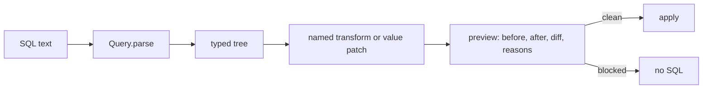
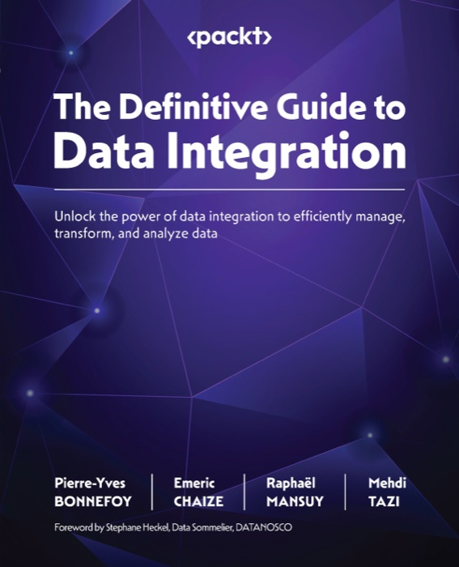
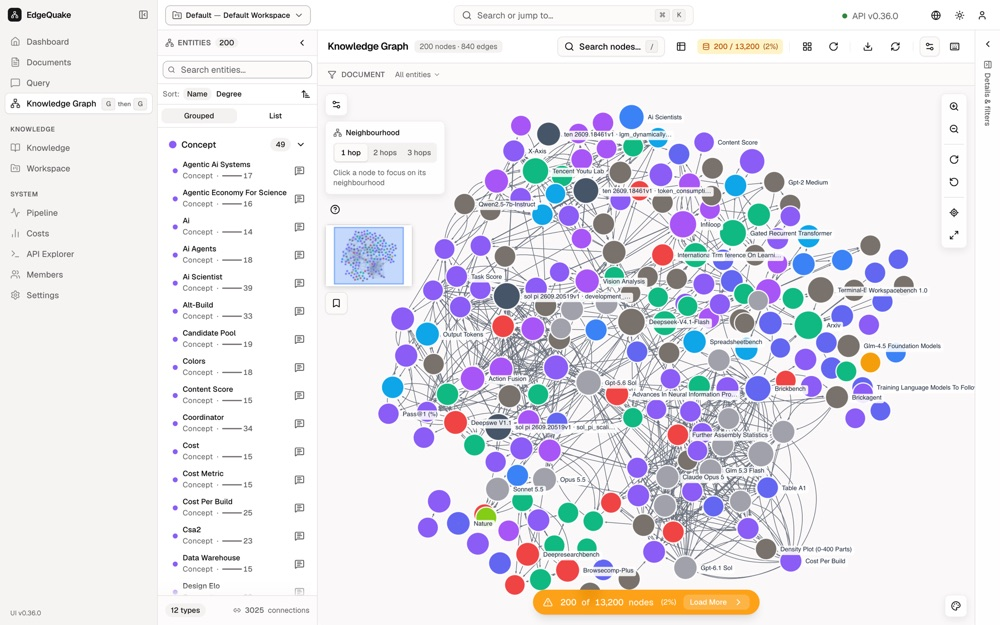

# EdgeSQL

**A Python library that parses Postgres and Databricks SQL, resolves every
column, and edits a typed syntax tree. Preview before apply. No string
replacement.**

EdgeSQL is a SQL parser, SQL rewriter, and query builder for Python. It reads a
statement, resolves every column against its real table, and edits a copy of the
syntax tree. It prints the result in the same dialect. It never edits SQL text
with string replacement, so a rename cannot break a comment, a literal, or a
second edit on the same name.

Use EdgeSQL to rename a column safely, patch a filter value, change a range, a
list, or a limit, rewrite a `WHERE` clause, add or drop a CTE, and build a
dynamic filter screen from any query.

Supported dialects: `postgres` and `databricks`.

- PyPI: <https://pypi.org/project/edgesql/>
- Documentation and tutorial: <https://raphaelmansuy.github.io/EdgeSQL/>
- Example app: `examples/report-helper` (FastAPI and native HTML)
- Licence: Apache 2.0

```python
from edgesql import Query

query = Query.parse("SELECT cust_id FROM sales.orders WHERE cust_id = 42", dialect="postgres")
print(query.to_sql())
# SELECT cust_id FROM sales.orders WHERE cust_id = 42
```

## Why not string replacement

| Task | String replacement | EdgeSQL |
| --- | --- | --- |
| Rename `cust_id` | Changes comments and literals too | Changes only the resolved column |
| Know the owner table | Guess from the text | Reports the physical table and the CTE hops |
| Two edits on one name | The second edit corrupts the first | Each edit runs on a copy of the tree |
| Check the result | Read the diff by eye | Preview blocks a change that cannot reparse |
| Change a filter value | Build a new SQL string | Patches one node and keeps the operator |

## Install

From PyPI with pip:

```bash
pip install edgesql
```

With `uv`, which resolves and installs in one step:

```bash
uv add edgesql            # add it to a project
uv pip install edgesql    # or install into the active environment
```

To run it once without installing it:

```bash
uvx --from edgesql python -c "from edgesql import Query; print(Query.parse('SELECT 1', dialect='postgres').to_sql())"
```

Check the install:

```bash
python -c "import edgesql, importlib.metadata as m; print(m.version('edgesql'))"
```

To add the optional Postgres check with `pglast`:

```bash
pip install "edgesql[postgres]"      # or: uv add "edgesql[postgres]"
```

## Install from the repository

For development, clone the repository and use the `dev` extra. It adds pytest,
FastAPI, uvicorn, Playwright, and ruff.

```bash
git clone https://github.com/raphaelmansuy/EdgeSQL.git
cd EdgeSQL
python3 -m venv .venv
.venv/bin/pip install -e ".[dev]"
```

With `uv`, the same step is:

```bash
uv venv
uv pip install -e ".[dev]"
```

## The two ways to change a query

A `Query` is immutable. Each method returns a new `Query` and leaves the
original unchanged.

1. Lane B: a named transform returns a new `Query`. Preview it, then apply it.
2. Lane A: a value patch replaces one comparison value, range, list, or limit.

Both lanes pass through `preview()`. Apply is the only commit.



## Read a statement

```python
query = Query.parse(sql, dialect="postgres")

query.tables()  # ['sales.orders', 'sales.customers']
query.ctes()  # ['paid']
query.columns()  # ColumnRef objects with table, name, and hop list
query.filters()  # one Filter per conjunct
query.params()  # marker names, for example '1' or 'fare_parameter'
query.to_tree()  # the product IR, schemaVersion '0.1'
```

`filters()` returns one item per conjunct. An `OR` group is one item. Each
item reports its `scope`, `clause`, `op`, `values`, and the columns it touches.
The hop list records the CTEs and derived tables on the path to the physical
table.

## Rename a column with preview and apply

```python
query = Query.parse(
    "SELECT cust_id, status FROM sales.orders",
    dialect="postgres",
)

preview = query.preview(lambda item: item.rename_column("cust_id", "customer_id", table="sales.orders"))

if preview.blocked:
    print(preview.blocked_reasons)
else:
    applied = preview.apply(actor="builder")
    print(applied.to_sql())
    # SELECT customer_id AS cust_id, status FROM sales.orders
```

The output name stays `cust_id`. Set `keep_output_names=False` to change it.

`preview()` computes these fields:

| Field | Meaning |
| --- | --- |
| `before_sql` | Pretty SQL of the original |
| `after_sql` | Pretty SQL of the result |
| `ast_diff` | Edit script from `sqlglot.diff` |
| `semantic_diff` | Tables, filters, joins, projection, and limit |
| `blocked_reasons` | Empty when the preview is clean |
| `collapsed` | True when the pretty SQL did not change |
| `fingerprint` | First 16 hex characters of SHA-256 of canonical SQL |

`apply()` raises `BLOCKED` when the preview is blocked. A second apply of the
same preview returns the same fingerprint.

## Patch one value

A value patch needs a node id from `to_tree()`. It replaces the right-hand
value only.

```python
query = Query.parse(
    "SELECT cust_id, status FROM sales.orders WHERE cust_id = 42 AND status = 'paid'",
    dialect="postgres",
)

patched = query.set_params([{"op": "set_comparison", "nodeId": "n_cmp_cust_eq", "params": {"value": 99}}])
preview = query.preview(lambda _item: patched)
applied = preview.apply(actor="reader")
```

The allowed operations are `set_comparison`, `set_between`, `set_in_list`, and
`set_limit`. A patch that sends `left`, `op`, `column`, or `children` raises
`STRUCTURE_PATCH`.

A comparison is editable only when its right side is a literal, a boolean, a
`NULL`, a negative number, or a parameter marker. A comparison against another
column or a function is read-only, because a value patch would change the
meaning.

## Edit a filter in place

```python
from edgesql import col

query = Query.parse(sql, dialect="postgres")
wider = query.cte("paid").and_where(col("region").eq("EU"))

status = query.filters().where(column="status")[0]
without = query.remove_filter(status)
```

## Build a query

```python
from edgesql import col, param, select

query = select("sales.orders").where(col("status").eq("paid")).where(col("amount").gt(param("floor"))).limit(100)
print(query.to_sql("postgres"))
print(query.to_sql("databricks"))
```

A built query has no parse dialect, so both dialects are available. A parsed
query keeps its dialect. `to_sql` with another dialect raises `CROSS_DIALECT`.

## Dialect rules

| Topic | Rule |
| --- | --- |
| Dialect | `postgres` or `databricks`, always explicit |
| Markers | Postgres prints `$1`; Databricks keeps `:name` and `?` |
| QUALIFY | Databricks only |
| SEMI and ANTI joins | Databricks only |
| DISTINCT ON and FETCH | Postgres only, and `FETCH` refuses on Databricks |
| Recursive CTE | `UNION ALL` on Databricks; `MAX RECURSION LEVEL` is preserved |
| Root statement | `SELECT` and `WITH` only |
| Mixed markers | `:name` with `?` in one Databricks statement raises `MIXED_MARKERS` |

## Errors

Every error carries a phase, a code, an optional hint, and a 12 character
track id. The display text is `[phase/code] message`, plus `Hint: ` when a hint
exists.

| Phase | Codes |
| --- | --- |
| parse | `UNKNOWN_DIALECT`, `EMPTY_SQL`, `PARSE_FAILED`, `MULTI_STATEMENT`, `UNSUPPORTED_STATEMENT`, `DIALECT_NODE`, `MIXED_MARKERS` |
| resolve | `AMBIGUOUS_COLUMN`, `UNKNOWN_SOURCE`, `UNKNOWN_COLUMN` |
| transform | `UNKNOWN_SCOPE`, `UNSUPPORTED_REMOVE`, `UNSUPPORTED_NODE`, `DUPLICATE_CTE`, `CTE_IN_USE`, `RECURSIVE_PROJECTION`, `STRUCTURE_PATCH`, `UNKNOWN_NODE`, `NOT_IN_V1` |
| preview and apply | `BLOCKED` |
| render | `CROSS_DIALECT` |

```python
from edgesql import Query, SqlCraftError

try:
    Query.parse("DELETE FROM sales.orders", dialect="postgres")
except SqlCraftError as error:
    print(error.display())
    # [parse/UNSUPPORTED_STATEMENT] This statement is DELETE. v1 changes read statements only.
    # Hint: v1 accepts `SELECT` and `WITH ... SELECT`.
```

Blocked reasons are strings, not codes: `NO_MATCH`, `REPARSE_FAILED`,
`TABLE_SET_CHANGED`, `DISALLOWED_STATEMENT`, and `MIGRATE_STUB`.

## The report helper

`examples/report-helper` is a FastAPI app with a native HTML screen. The screen
builds its filter panel from the product IR. Every editable node becomes a
control: a text field, a number field, a boolean choice, a range, a list, or a
limit. Read-only predicates show their printed text.

```bash
make dev      # http://127.0.0.1:8765
```

## Development

```bash
make install       # virtual environment, library, dev tools, Chromiummake dev           # serve the report helper
make site          # serve the tutorial site
make check         # lint, formatting, and every test
make test          # the whole suite
make test-lib      # library and official SQL suites
make test-http     # HTTP status map
make test-docs     # docs site checks
make test-e2e      # browser flow and screenshots
make screenshots   # list the saved screenshots
make lint          # style, imports, and formatting
make fmt           # apply formatting and safe fixes
make build         # sdist and wheel into dist/
make clean         # remove caches and build output
```

Tests cover the prototype cases, every error code, the official Postgres
regression files, the Databricks manual examples, the HTTP status map, the docs
site, and the browser flow. Screenshots are in
`specs/01-first-spec/e2e/screenshots`.

## Publishing

The package builds and validates with `make release-check`.

```bash
make release-check   # build the sdist and the wheel, then check the metadata
make publish-test    # upload to TestPyPI
make publish         # upload to PyPI
```

CI publishes from [.github/workflows/publish.yml](.github/workflows/publish.yml)
when you publish a GitHub release. Setup and the release checklist are in
[docs/PUBLISHING.md](docs/PUBLISHING.md).

## Tutorial

A step by step tutorial, the full example gallery, and the API reference are on
the published site: <https://raphaelmansuy.github.io/EdgeSQL/>. The source is in
[docs/](docs/index.html). Serve it locally with `make site`.

## Questions

**Can EdgeSQL rename a column without touching comments or string literals?**
Yes. The rename resolves the column to its table and edits only that column. A
comment that contains the old name keeps its text.

**Does it support CTEs, subqueries, and Recursive CTEs?**
Yes. It resolves CTEs, derived tables, set operations, recursive CTEs, `LATERAL`
sources, and correlated subqueries. A filter reports the CTE hops on the path to
the physical table.

**Can it change a filter value without rewriting the SQL string?**
Yes. `set_params` replaces the right-hand value of one node and keeps the column,
the operator, and the structure.

**Does it work with Databricks and Postgres?**
Yes. Both dialects are supported. `QUALIFY`, `SEMI`, and `ANTI` joins are
Databricks only. `DISTINCT ON` and `FETCH` are Postgres only. A cross-dialect
emit raises `CROSS_DIALECT` rather than printing a quiet substitute.

**Does it connect to a database?**
No. EdgeSQL reads and writes SQL text. It does not run a query and does not need
a connection. Pass `schema` to disambiguate a column when a statement joins two
tables.

**Can a web form change a query safely?**
Yes. The report helper builds its filter panel from the product IR, so any query
gets controls that match its predicates. A change that cannot reparse is blocked,
and Apply stays disabled until a clean preview exists.

**What are the limits?**
`inline_cte` and `rewrite` are not in v1, and `migrate` returns a blocked preview.
A transform that changes a recursive CTE projection is refused.

## Author


Raphael Mansuy is a data engineering and AI strategist with more than 20 years
of global technology leadership experience. He works on democratizing data
management and AI, and helps organizations build scalable data platforms. His
work covers resilient data infrastructure, machine learning models, and coaching
teams on practice. He leads a startup studio in Hong Kong and writes about AI
and data strategy.

EdgeSQL started from a simple observation: changing SQL with string replacement
breaks as soon as two edits touch the same name. A typed tree with a preview gate
is the smallest honest fix.

- LinkedIn: [linkedin.com/in/raphaelmansuy](https://www.linkedin.com/in/raphaelmansuy/)
- Repository: [github.com/raphaelmansuy/EdgeSQL](https://github.com/raphaelmansuy/EdgeSQL)
- Tutorial site: [raphaelmansuy.github.io/EdgeSQL](https://raphaelmansuy.github.io/EdgeSQL/)
- PyPI: [pypi.org/project/edgesql](https://pypi.org/project/edgesql/)

[Connect with Raphael on LinkedIn](https://www.linkedin.com/in/raphaelmansuy/).

### Recognition

Favikon ranks Raphael at **12** in [Top 20 AI Experts in France in
2026](https://www.favikon.com/blog/top-ai-experts-france), with a Favikon
Authority Score of 7,012 points. The list covers the most visible AI
practitioners in France, and the entry cites his 20 years of data and AI
leadership and his work on scalable data platforms.

### Book



[**The Definitive Guide to Data Integration**](https://www.oreilly.com/library/view/the-definitive-guide/9781837631919/)
(Packt, 2024). Subtitle: *Unlock the power of data integration to efficiently
manage, transform, and analyze data*. Raphael is a co-author with Pierre-Yves
Bonnefoy, Emeric Chaize, Mehdi Tazi, and Stephane Heckel. The book is available
through O'Reilly.

### Other projects by Raphael

<table>
<tr>
<td width="220"></td>
<td>

**[EdgeQuake](https://edgequake.com/)** - Graph-RAG in Rust: one binary, one
Postgres, any LLM. It reads PDFs and text, builds a knowledge graph in
PostgreSQL, and answers questions with sources. Six retrieval modes: naive,
local, global, hybrid, mix, and bypass. Apache 2.0.

</td>
</tr>
<tr>
<td></td>
<td>

**[EdgeCrab](https://www.edgecrab.com/)** - a personal and coding SuperAgent in
one native Rust binary, with a ratatui terminal UI and a ReAct tool loop. It
supports 24 LLM providers and 17 messaging gateways. Install with
`npm install -g edgecrab-cli`, `pip install edgecrab-cli`, or
`cargo install edgecrab-cli`.

</td>
</tr>
<tr>
<td></td>
<td>

**[EdgeWhisper](https://edgewhisper.com/)** - voice dictation for macOS, powered
by Voxtral from Mistral AI. It runs fully on the device, with no cloud and no
data collection. It supports 13 languages, an Apple Silicon Mac, and macOS 14
or later.

</td>
</tr>
</table>

## License

Copyright 2026 Raphael Mansuy.

Licensed under the Apache License, Version 2.0. See [LICENSE](LICENSE) for the
full text and [NOTICE](NOTICE) for the attribution of third-party components.

SQLGlot supplies the parser and the printer and keeps its own MIT license. The
Postgres regression fixtures keep the PostgreSQL license, and the Databricks
examples come from the Databricks documentation.

