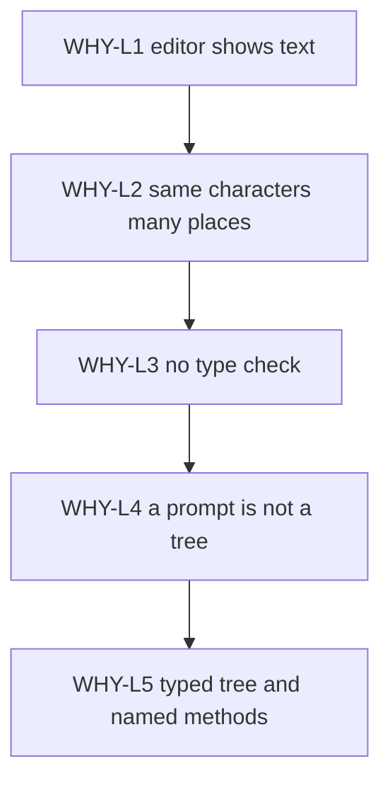
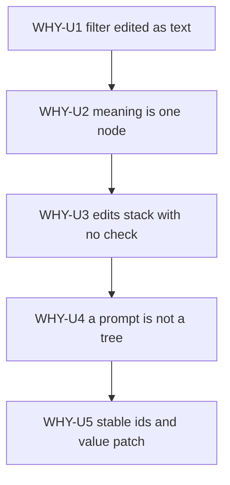

# Five whys

Date: 2026-10-28 (Asia/Hong Kong).

Start here. The two chains below are the reason for every later rule. [01-principles.md](01-principles.md) turns the last why of each chain into rules that do not move.

A why answers the previous why. It does not add a new feature.

## Library chain

People change live report SQL with find-and-replace. The task in the parent page is small. Rename `cust_id` to `customer_id` on `sales.orders`. Leave comments, string literals, and other tables alone.

### WHY-L1

People edit the SQL as text because the editor shows text.

A string replace is the tool in front of them. The editor does not show a column node, a comment node, or a literal node.

### WHY-L2

The same characters can sit in more than one place.

`cust_id` can be a column on `sales.orders`. It can be a column on another table. It can be a comment. It can be a string literal. A text replace cannot tell those places apart.

### WHY-L3

Each text edit has no type check.

The next edit stacks on the previous text. A rename can hit a string. A `WHERE` append can land inside the wrong query. A function swap can break on Postgres or on Databricks. The errors stack because no step names the node it changed.

### WHY-L4

A better prompt does not give a tree that a program can check.

An agent can write careful prose. The prose is still text. Without a parse and without types, nobody can prove that the edit touched the node the caller named.

### WHY-L5

The object you can validate is a typed tree with a small set of named methods.

The caller names the dialect. The library parses the text. A method such as `rename_column` changes only the nodes that resolve to the named table. Preview shows the result. Apply commits only after a green preview.

### GOV-L1

String edits cannot change SQL meaning in a safe way when edits stack.

### GOV-L2

A tree that names its dialect and that round-trips for the v1 subset makes tools checkable.

The method set stays small. The tools are rewrite, lint, migrate, and agent checks.

`GOV-L1` and the two sentences above are the governing lines from the parent page.

## Screen chain

A BI reader changes one filter on a live board-pack query. Example: `status = 'paid'` becomes `status = 'refunded'`. The reader does not edit the SQL text.

### WHY-U1

People edit filter values in SQL text because that is what the editor shows.

### WHY-U2

The meaning sits in one comparison node.

The same characters can sit in a comment or in the wrong clause. A hand edit of the literal can break a quote. The pack then fails at run time, or the numbers go wrong and the SQL still looks fine.

### WHY-U3

Chained text edits have no type check.

An agent and a hurried person both add the next edit to the same text. The damage stacks.

### WHY-U4

A better prompt does not give a tree that a program can check.

The screen has the same gap as the library. A dropdown that pastes a value into a text template brings the string bug back.

### WHY-U5

The screen can patch a typed tree that has stable node ids.

The tree splits parameter values from structure. Apply round-trips and fails closed. The HTML5 form edits the value only. `sqlcraft` remains the only SQL authority.

### GOV-U1

Show the live query as a typed tree so a BI reader changes filter values on the screen. The helper rewrites only those nodes, previews the SQL, and refuses an unsafe edit.

## What the chains rule out

`WHY-L2` rules out a string replace helper. See [KILL-01](01-principles.md#kill-01).

`WHY-L4` rules out an LLM call inside the library. See [KILL-06](01-principles.md#kill-06).

`WHY-U4` rules out a template that injects a filter value into SQL text. See [KILL-12](01-principles.md#kill-12).

`WHY-U5` is [LANE-A](10-product-ir.md#lane-a). Structure edits stay on [LANE-B](10-product-ir.md#lane-b).
