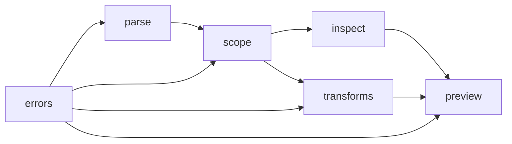

# Principles

Date: 2026-10-28 (Asia/Hong Kong).

These rules come from [WHY-L5](00-five-whys.md#why-l5) and [WHY-U5](00-five-whys.md#why-u5). A later file does not repeat them. It links here.

## First principles

### FP-1

SQL meaning lives in nodes. It does not live in a character span.

A comment, a literal, and a column can share the same characters. The library finds the node.

### FP-2

The caller names the dialect on parse and on emit.

The dialects in v1 are `postgres` and `databricks`. The library does not detect the dialect.

### FP-3

A transform returns a new `Query`.

The caller keeps the old `Query`. Preview can show both. The pattern name is copy-on-write. See [TERM-COW](02-glossary.md#term-cow).

### FP-4

On unknown or unsafe input, the library raises or blocks.

The library does not guess a table. It does not drop a clause. It does not emit SQL after a blocked preview. The rule name is fail closed. See [TERM-FAIL-CLOSED](02-glossary.md#term-fail-closed).

### FP-5

The library does not run the query.

The library does not open a network connection. It does not read a catalog. A `schema` argument is data that the caller passes. [MOD-SCOPE](03-library-architecture.md#mod-scope) uses that argument only to resolve a name.

### FP-6

A bind marker stays a bind marker.

The library does not paste a user value into SQL text. Builders and Lane A write values as literals only when the caller already holds a typed value on the server. Agents pass `param(...)`. See [API-PARAM](03-library-architecture.md#api-param).

### FP-7

A comment stays on its node.

A rename does not change comment text. When a node moves, the comment moves with the node.

### FP-8

Callers see one public tree.

SQLGlot holds the private syntax tree. pglast is an optional Postgres check. Callers never see two trees. See [DEC-1](01-principles.md#dec-1).

## Non-negotiables

### NN-01

Dialect is explicit on parse and on emit. A mismatch raises [ERR-CROSS-DIALECT](09-error-catalog.md#err-cross-dialect).

### NN-02

Round-trip or confess. Parse, then print, keeps the meaning for the v1 subset. If the library cannot keep the meaning, it raises. The message names the phase and the code. A source span is present only when the engine has one. See [DEC-2](01-principles.md#dec-2).

### NN-03

Every node has a type. The product IR also marks `editable`. See [IR-NODE](10-product-ir.md#ir-node).

### NN-04

Unknown constructs fail closed. The library does not drop a clause in silence.

### NN-05

Fluent methods are sugar over tree operations.

There is no hidden planner. There is no network I/O and no catalog I/O inside the library.

### NN-06

Cross-dialect emit is identity only when the nodes exist in both dialects.

Any other emit goes through `migrate`, then preview, then apply. `migrate` stays a stub until [OPEN-2](01-principles.md#open-2) closes. The library never transpiles in silence.

### NN-07

Two queries that differ by a dangerous clause do not both pass the same safe gate.

Apply stays off for a `DELETE` or an `UPDATE` that has no `WHERE`. Read agents accept `SELECT` and `WITH` only. See [TEST-BREAK-DML](13-verification-and-traceability.md#test-break-dml).

## DRY

One fact, one place.

### DRY-1

One function resolves columns. `filters`, `rename_column`, and `columns` call it. The function lives in [MOD-SCOPE](03-library-architecture.md#mod-scope). The steps are [RES-1](05-scope-and-resolution.md#res-1) through [RES-6](05-scope-and-resolution.md#res-6).

### DRY-2

One error catalog. HTTP uses the same codes. The catalog is [09-error-catalog.md](09-error-catalog.md).

### DRY-3

One accept matrix. The library and the HTTP example both use [ACC-MUST](08-preview-apply-audit.md#acc-must), [ACC-REFUSE](08-preview-apply-audit.md#acc-refuse), and [ACC-COLLAPSE](08-preview-apply-audit.md#acc-collapse).

### DRY-4

One conjunct splitter. Filter extraction uses it. The splitter is [FLT-1](06-inspection.md#flt-1).

### DRY-5

Each specification rule has one home file. A second file links to the identifier. It does not copy the rule.

## SOLID

The module split in [03-library-architecture.md](03-library-architecture.md) is the shape of these rules.

### SOL-S

One module, one responsibility.

`parse` gates input. `scope` resolves names. `inspect` reads.

`transforms` copies and edits. `preview` judges. `errors` holds codes.

`build` makes new trees. A dialect file holds dialect facts only.

### SOL-O

A new dialect adds a file under `sqlcraft/dialects/`.

Core verbs do not grow a dialect branch. Postgres-only and Databricks-only helpers live in the dialect file. See [MOD-DIALECTS](03-library-architecture.md#mod-dialects).

### SOL-L

`Query.cte(name)` returns a `Query`.

The same verbs apply. A scoped call still returns a whole `Query`, not a private subtype that breaks the caller.

### SOL-I

Level 0 is six verbs: `parse`, `rename_column`, `and_where`, `filters`, `preview`, `to_sql`.

`rewrite(fn)` is a separate interface. Agents do not receive it in v1. See [KILL-14](01-principles.md#kill-14) and [API-REWRITE](03-library-architecture.md#api-rewrite).

### SOL-D

Callers depend on `Query`, `Filter`, `Preview`, and `SqlCraftError`.

Callers do not depend on a SQLGlot `Expression`. The product IR is opaque. See [DEC-1](01-principles.md#dec-1).

The arrows point at the dependency. `preview` is the only module that sees both inspect and transforms. Nothing imports `preview` except the `Query` facade.

## Decisions already made

### DEC-1

The public product IR is opaque.

SQLGlot `Expression` stays private. The JSON shape is [10-product-ir.md](10-product-ir.md). Callers do not send a full tree back. See [KILL-13](01-principles.md#kill-13).

### DEC-2

Column spans are absent. The specification records that absence.

SQLGlot 30.25.0 left `Column.meta` empty on parsed columns. Parse errors still carry line and column. See [PIN-SPAN](04-parsing-and-dialects.md#pin-span).

### DEC-3

The Databricks v1 surface is the shared `SELECT` subset plus `QUALIFY`.

It is not the full language manual. See [DIAL-DBX](04-parsing-and-dialects.md#dial-dbx).

### DEC-4

pglast is an optional extra. It is not a hard dependency at launch.

When you install the extra, a Postgres parse must also parse with pglast. A miss raises [ERR-PARSE-FAILED](09-error-catalog.md#err-parse-failed). pglast never becomes a second public tree.

### DEC-5

`filters().to_dicts()` uses a column object, not a dotted string.

The object keeps `table`, `name`, and the hop list. The prototype kept `table.name` text. The parent page requires the hop list, so the object form is the frozen shape. See [FLT-3](06-inspection.md#flt-3).

## Open items

Each open item has one home: this section.

### OPEN-1

The set leaves the public package name open.

`sqlcraft` is the working name in this set. PyPI already has a package named `sqlcraft` (0.1.x). Do not publish under that name. Choose a free name before the first release.

### OPEN-2

Versioned migrate maps do not exist yet.

`migrate(target)` is a stub. It is outside the agent allowlist. There is no silent transpile. See [API-MIGRATE](03-library-architecture.md#api-migrate).

### OPEN-3

`lint(rules)` is a fast-follow.

Findings will carry a rule id, a message, and a span when a span exists.

### OPEN-4

The `WINDOW` clause is a fast-follow.

`QUALIFY` on Databricks is in v1 because the prototype extracts it. A named `WINDOW` clause waits until the `SELECT` goldens pass.

### OPEN-5

Select options on the HTML5 screen are a static list in v1.

A later version can read options from a catalog. The library still does no catalog I/O. See [UX-STATUS](12-html5-ux.md#ux-status).

### OPEN-6

Lane A patches the right-hand value only.

An operator allowlist is not in v1. Add it only after an explicit product decision.

## Keep for v1

### KEEP-01

`Query.parse(sql, dialect)` returns a `Query` or raises.

### KEEP-02

`tables`, `ctes`, `columns`, `filters`, and `params` are the read probes.

### KEEP-03

`rename_column(old, new, table=...)` renames only columns that resolve to that table.

Output names stay unless the caller passes `keep_output_names=False`. Comments and literals stay.

### KEEP-04

`cte(name)` returns a scoped `Query`. `with_cte`, `rename_cte`, and `drop_cte` are named CTE verbs. `inline_cte` stays a fast-follow. See [XFM-CTE](07-transforms.md#xfm-cte).

### KEEP-05

`remove_filter` and `replace_filter` take a `Filter` value.

The library refuses an `OR` branch. See [FLT-2](06-inspection.md#flt-2).

### KEEP-06

`schema=` on parse resolves an unqualified column in a join.

Zero owners or several owners raise [ERR-AMBIGUOUS-COLUMN](09-error-catalog.md#err-ambiguous-column).

### KEEP-07

`and_where` appends a predicate in a named scope.

### KEEP-08

`to_sql(dialect)` prints SQL for the same dialect only.

### KEEP-09

`preview(fn)` proposes a transform. `preview()` with no function snapshots the current tree.

### KEEP-10

`preview.apply()` returns a `Query` only after a green preview.

The audit record is [AUD-1](08-preview-apply-audit.md#aud-1).

### KEEP-11

The accept matrix is Must, Refuse, and Collapse. See [DRY-3](01-principles.md#dry-3).

### KEEP-12

Builders `select`, `col`, and `param` create a tree. They do not paste strings.

## Kill for v1

### KILL-01

No string `replace` and no regular expression on SQL text.

### KILL-02

No dialect auto-detect as the default.

### KILL-03

No silent drop of an unsupported clause.

### KILL-04

No free silent cross-dialect transpile.

### KILL-05

No ORM that hides SQL. That product is a different product.

### KILL-06

No LLM call inside the library. Models call the library. The library does not call a model.

### KILL-07

No warehouse beyond Postgres and Databricks until those two are solid.

### KILL-08

No full PL/pgSQL coverage.

### KILL-09

No query planner and no auto-optimize.

### KILL-10

No plugin market before round-trip goldens pass.

### KILL-11

No GUI inside the library. The HTML5 screen is a separate example. See [11-fastapi-example.md](11-fastapi-example.md).

### KILL-12

No Jinja `{{filter}}` SQL. The screen does not paste a value into a template.

### KILL-13

No client `from_json_tree`. The browser does not replace the syntax tree.

### KILL-14

`rewrite(fn)` is not on the agent allowlist. A human gate is required if a builder calls it.

### KILL-15

React is not a requirement for the example screen.
