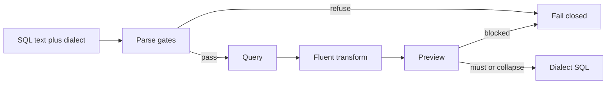

# Library architecture

Date: 2026-10-28 (Asia/Hong Kong). Working name: `sqlcraft`.

This file maps modules, public names, and the hero path. Algorithms live in the files that this map links to. Principles live in [01-principles.md](01-principles.md).

The library is a thin product layer over SQLGlot. There is no second grammar. See [FP-8](01-principles.md#fp-8) and [DEC-1](01-principles.md#dec-1).

## Package

```text
sqlcraft/
  __init__.py
  parse.py
  scope.py
  inspect.py
  transforms.py
  preview.py
  errors.py
  build.py
  dialects/postgres.py
  dialects/databricks.py
```

`__init__.py` exports `Query`, `col`, `select`, `param`, and `SqlCraftError`.

The dependency rule is one way. `parse` comes before `scope`. `scope` comes before `inspect` and `transforms`. `preview` sits on top. Only the `Query` facade imports `preview`. The diagram is in [01-principles.md](01-principles.md#sol-d).

## MOD-PARSE

`parse.py` owns the dialect gate, the single-statement gate, and the statement-kind allowlist.

`Query.parse` is the only entry. The gates are [GATE-1](04-parsing-and-dialects.md#gate-1) through [GATE-6](04-parsing-and-dialects.md#gate-6).

## MOD-SCOPE

`scope.py` owns the scope tree, the source map, and column resolution.

The public value is `ColumnRef`. The steps are [RES-1](05-scope-and-resolution.md#res-1) through [RES-6](05-scope-and-resolution.md#res-6). [DRY-1](01-principles.md#dry-1) forbids a second resolver.

The schema argument is caller data. The module does not open a catalog. See [FP-5](01-principles.md#fp-5).

## MOD-INSPECT

`inspect.py` owns `tables`, `ctes`, `columns`, `filters`, and `params`.

The public values are `Filter` and `FilterSet`. The rules are [INS-TABLES](06-inspection.md#ins-tables) through [FLT-3](06-inspection.md#flt-3).

## MOD-TRANSFORMS

`transforms.py` owns copy-on-write edits.

Every edit addresses a handle or a scope name. The contract is [XFM-1](07-transforms.md#xfm-1). The verbs are [KEEP-03](01-principles.md#keep-03) through [KEEP-07](01-principles.md#keep-07) and [XFM-CTE](07-transforms.md#xfm-cte).

## MOD-PREVIEW

`preview.py` owns before SQL, after SQL, the AST diff, the semantic diff, blocked reasons, and the audit record.

`Preview` and `AuditRecord` are the public values. The rules are [PRV-1](08-preview-apply-audit.md#prv-1) and [AUD-1](08-preview-apply-audit.md#aud-1).

## MOD-ERRORS

`errors.py` owns `SqlCraftError`.

The fields and the codes live only in [09-error-catalog.md](09-error-catalog.md). See [DRY-2](01-principles.md#dry-2).

## MOD-BUILD

`build.py` owns `select`, `col`, and `param`.

These functions are thin wrappers over SQLGlot expression builders. They never paste a user string into SQL text. See [FP-6](01-principles.md#fp-6) and [API-SELECT](03-library-architecture.md#api-select).

## MOD-DIALECTS

`dialects/postgres.py` and `dialects/databricks.py` hold dialect facts.

Shared verbs stay in the core modules. The dialect file records the marker style, the quote characters, and the nodes that one dialect owns. See [SOL-O](01-principles.md#sol-o) and [DIAL-PG](04-parsing-and-dialects.md#dial-pg).

## Level 0

[SOL-I](01-principles.md#sol-i) names six verbs for the first import story.

| Order | Verb | Home |
| --- | --- | --- |
| 1 | `Query.parse` | [API-PARSE](03-library-architecture.md#api-parse) |
| 2 | `rename_column` | [XFM-RENAME](07-transforms.md#xfm-rename) |
| 3 | `and_where` | [XFM-WHERE](07-transforms.md#xfm-where) |
| 4 | `filters` | [FLT-1](06-inspection.md#flt-1) |
| 5 | `preview` | [PRV-1](08-preview-apply-audit.md#prv-1) |
| 6 | `to_sql` | [API-TO-SQL](03-library-architecture.md#api-to-sql) |

Other public methods exist in v1. They are not part of the first story.

## API-PARSE

```python
Query.parse(sql: str, *, dialect: str, schema: dict | None = None, mode: str = "library") -> Query
```

`dialect` is `postgres` or `databricks`. `schema` maps a table name to a list of column names. `mode` is `library` or `agent`.

A successful call returns a `Query`. Every column on that object resolves. See [GATE-6](04-parsing-and-dialects.md#gate-6).

`mode="agent"` uses the same gates. The HTTP example and the agent allowlist both use it. See [API-AGENT](03-library-architecture.md#api-agent).

## API-TO-SQL

```python
query.to_sql(dialect: str | None = None, pretty: bool = False) -> str
```

If the caller omits `dialect`, the method uses the parse dialect. If `dialect` differs, the method raises [ERR-CROSS-DIALECT](09-error-catalog.md#err-cross-dialect). See [NN-06](01-principles.md#nn-06).

`pretty=False` is the canonical text. The fingerprint hashes that text. See [TERM-FP](02-glossary.md#term-fp).

## API-SELECT

```python
select(table: str) -> Query
col(name: str) -> ColumnBuilder
param(name: str) -> BindBuilder
```

`select("sales.orders").where(col("status").eq("paid")).limit(10)` builds a tree from scratch.

`to_sql("postgres")` and `to_sql("databricks")` are both legal when every node exists in both dialects. Otherwise the caller uses [API-MIGRATE](03-library-architecture.md#api-migrate).

`col("status").eq(param("status"))` builds a comparison. The right side is a bind marker. See [FP-6](01-principles.md#fp-6).

The library trusts a string passed to `and_where`. User input uses the builders.

## API-MIGRATE

```python
query.migrate(target: str) -> Preview
```

v1 returns a blocked preview. The blocked reason is `MIGRATE_STUB`. See [OPEN-2](01-principles.md#open-2) and [ERR-MIGRATE-STUB](09-error-catalog.md#err-migrate-stub).

The method does not print the other dialect.

## API-REWRITE

```python
query.rewrite(fn) -> Query
```

Not in v1. A call raises [ERR-NOT-IN-V1](09-error-catalog.md#err-not-in-v1).

Agents never receive this name. See [KILL-14](01-principles.md#kill-14).

## API-AGENT

Agent mode is `Query.parse(..., mode="agent")`.

The allowlist is `parse`, `tables`, `ctes`, `columns`, `filters`, `params`, `rename_column`, `and_where`, `remove_filter`, `replace_filter`, `preview`, `apply`, and `to_sql`.

The allowlist omits `rewrite`, `migrate`, and any string replace. `to_sql` is not a commit. A green preview comes first. See [PRV-APPLY](08-preview-apply-audit.md#prv-apply).

Secrets never enter the syntax tree and never enter a log. A secret is a password, a token, or a connection string.

## SAMPLE-1

Hero rename. Dialect `postgres`. Fictional table `sales.orders`.

```sql
SELECT cust_id, status, amount
FROM sales.orders
WHERE status = 'paid'
-- note: legacy cust_id naming
```

## SAMPLE-2

Scope, filters, and rename. The prototype tests use this text.

```sql
WITH paid AS (
  SELECT o.cust_id, o.amount FROM sales.orders o
  WHERE o.status = 'paid' AND o.amount > 0 -- legacy cust_id
)
SELECT p.cust_id, SUM(p.amount) AS total
FROM paid p JOIN sales.customers c ON c.id = p.cust_id AND c.region IN ('EU','US')
WHERE p.cust_id IS NOT NULL AND (p.amount BETWEEN 1 AND 10 OR p.amount > 500)
GROUP BY p.cust_id HAVING SUM(p.amount) > 100
```

## SAMPLE-3

Lane A value edit. The HTML5 screen loads this text.

```sql
SELECT cust_id, status, amount
FROM sales.orders
WHERE cust_id = 42 AND status = 'paid'
```

## Hero path

The path is parse, rename, preview, apply, then `to_sql`. A builder who wants a new query uses [API-SELECT](03-library-architecture.md#api-select) instead. Compile does not run the query. See [FP-5](01-principles.md#fp-5).

```python
from sqlcraft import Query

sql = """
SELECT cust_id, status, amount
FROM sales.orders
WHERE status = 'paid'
-- note: legacy cust_id naming
"""

q = Query.parse(sql, dialect="postgres")
preview = q.preview(lambda t: t.rename_column("cust_id", "customer_id", table="sales.orders"))

if preview.blocked:
    raise SqlCraftError("preview", "BLOCKED", "; ".join(preview.blocked_reasons))

q2 = preview.apply(actor="builder")
assert q is not q2
print(q2.to_sql("postgres"))
```

`preview.before_sql`, `preview.after_sql`, `preview.ast_diff`, and `preview.blocked_reasons` are the evidence. `preview()` with no function snapshots the current tree and does not propose a change.

Same-dialect emit only. Cross-dialect work is [API-MIGRATE](03-library-architecture.md#api-migrate).

## Work sequence

The prototype is one file plus tests. v1 splits that file and keeps the tests green. The sequence is:

1. Split the prototype into the modules in this file.
2. Add `cte(name)`, `columns` with usage tags, and `params`.
3. Add `replace_filter`, `rename_cte`, `with_cte`, and `drop_cte`.
4. Add `select`, `col`, and `param`.
5. Add the AST diff and `TABLE_SET_CHANGED`. Freeze `to_dicts` as [FLT-3](06-inspection.md#flt-3).
6. Add the official fixtures in [CASE-SUITE-PG](13-verification-and-traceability.md#case-suite-pg) and [CASE-SUITE-DBX](13-verification-and-traceability.md#case-suite-dbx).
7. Choose the public package name. See [OPEN-1](01-principles.md#open-1).

## Pipeline



Phases on the object are `parse`, `resolve`, `transform`, `preview`, `apply`, and `render`. The terminal states are done and failed. A transform is never half applied. See [FP-3](01-principles.md#fp-3) and [ACC-MUST](08-preview-apply-audit.md#acc-must).
