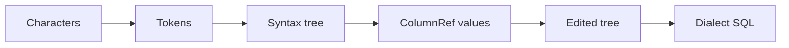

# Parsing and dialects

Date: 2026-10-28 (Asia/Hong Kong).

This file is the home for parse gates and for Postgres and Databricks pins. The library does not invent a grammar. SQLGlot is the grammar. See [FP-8](01-principles.md#fp-8).

Reference parser: SQLGlot 30.25.0. A later version must keep the pins in this file, and the changelog must name the version move.

## From characters to SQL

Five steps turn text into SQL again. The library owns steps 3 and 4. SQLGlot owns steps 1, 2, and 5.

### Step 1, tokens

The tokenizer splits text into keywords, identifiers, literals, comments, operators, and bind markers.

A comment is a token that stays attached to the nearest node. A bind marker is a token that is not a literal. See [FP-6](01-principles.md#fp-6) and [FP-7](01-principles.md#fp-7).

### Step 2, syntax tree

SQLGlot `parse` builds the private syntax tree. Use `sqlglot.parse`, not `parse_one`.

`parse` returns every statement. The library can then refuse a script. `parse_one` would keep the first statement and hide the rest.

The SQLGlot parser is lenient. A successful parse is not proof that the engine will run the query. [GATE-6](04-parsing-and-dialects.md#gate-6) and [PRV-REPARSE](08-preview-apply-audit.md#prv-reparse) add the checks the parser does not do.

### Step 3, names

The scope module resolves each column to a `ColumnRef`. The algorithm is [05-scope-and-resolution.md](05-scope-and-resolution.md).

A `Query` object exists only after this step passes.

### Step 4, edit

Transforms copy the tree and edit the copy. See [XFM-1](07-transforms.md#xfm-1).

### Step 5, print

`to_sql` asks SQLGlot to print the private tree in the parse dialect. See [API-TO-SQL](03-library-architecture.md#api-to-sql).

Whitespace can change on a round-trip. Meaning must not change for the v1 subset. See [NN-02](01-principles.md#nn-02).

## Gates

The gates run in this order. The first miss raises. The library does not continue.

### GATE-1

`dialect` is `postgres` or `databricks`.

Any other value raises [ERR-UNKNOWN-DIALECT](09-error-catalog.md#err-unknown-dialect). There is no auto-detect. See [KILL-02](01-principles.md#kill-02).

### GATE-2

The SQL text is non-empty after trim.

An empty string raises [ERR-EMPTY-SQL](09-error-catalog.md#err-empty-sql).

### GATE-3

SQLGlot either returns trees or raises `ParseError`.

On `ParseError`, the library raises [ERR-PARSE-FAILED](09-error-catalog.md#err-parse-failed). `line` and `col` come from `errors[0]` when that entry exists.

### GATE-4

The script contains one statement.

Zero statements or several statements raise [ERR-MULTI-STATEMENT](09-error-catalog.md#err-multi-statement).

`SELECT 1;` is one statement. The trailing semicolon does not add a second statement. `SELECT 1; SELECT 2` is a miss.

Official regression files end each statement with a semicolon. The suite runner splits the file. `Query.parse` still receives one statement. See [CASE-SUITE-PG](13-verification-and-traceability.md#case-suite-pg).

### GATE-5

The root node is a SQLGlot `Query`. That class covers `SELECT`, a set operation, and `WITH`.

Any other root, including `DELETE`, `UPDATE`, and `INSERT`, raises [ERR-UNSUPPORTED-STATEMENT](09-error-catalog.md#err-unsupported-statement). DML is out of v1. See [NN-07](01-principles.md#nn-07).

### GATE-6

Every column resolves.

A miss raises [ERR-AMBIGUOUS-COLUMN](09-error-catalog.md#err-ambiguous-column), [ERR-UNKNOWN-SOURCE](09-error-catalog.md#err-unknown-source), or [ERR-UNKNOWN-COLUMN](09-error-catalog.md#err-unknown-column).

Later layers trust this gate. They do not resolve a second way. See [DRY-1](01-principles.md#dry-1).

### GATE-7

The dialect file rejects a node that the named dialect does not accept.

A hit raises [ERR-DIALECT-NODE](09-error-catalog.md#err-dialect-node).

Postgres rejects `QUALIFY`, a `SEMI` join, an `ANTI` join, and `MAX RECURSION LEVEL`.

Databricks rejects `DISTINCT ON`, `FETCH`, and a recursive step that is not `UNION ALL`.

A Databricks statement that mixes `:name` and `?` raises [ERR-MIXED-MARKERS](09-error-catalog.md#err-mixed-markers).

The manuals are [REF-PG-SELECT](04-parsing-and-dialects.md#ref-pg-select), [REF-DBX-JOIN](04-parsing-and-dialects.md#ref-dbx-join), [REF-DBX-CTE](04-parsing-and-dialects.md#ref-dbx-cte), and [REF-DBX-PARAM](04-parsing-and-dialects.md#ref-dbx-param).

## DIAL-SHARED

Both dialects accept this v1 surface:

- `SELECT` and `WITH`, including `WITH RECURSIVE`
- `JOIN` and `ON`
- `WHERE`, `GROUP BY`, `HAVING`, `ORDER BY`, and `LIMIT`
- Comparisons `=`, `!=`, `>`, `>=`, `<`, `<=`
- `IN`, `BETWEEN`, `IS`, `LIKE`, `ILIKE`
- `UNION` and `UNION ALL`
- Comments and bind markers
- Common scalar functions and aggregates that SQLGlot already prints for both dialects

A node outside this list stays in the tree when the parser accepts it. A transform that would drop the node raises instead. See [NN-04](01-principles.md#nn-04).

`INTERSECT` and `EXCEPT` resolve with the same set-operation rule as `UNION`. See [RES-5](05-scope-and-resolution.md#res-5).

## DIAL-PG

Postgres facts that v1 pins:

- Unquoted identifiers fold to lower case in the engine. The library does not change case on its own. The printer owns quotes.
- Quoted identifiers use double quotes.
- `QUALIFY` is not a Postgres clause. A Postgres parse of `QUALIFY` fails [GATE-3](04-parsing-and-dialects.md#gate-3) or [GATE-5](04-parsing-and-dialects.md#gate-5).
- Bind markers include `$1` and `%(name)s`.
- [PIN-PARAM](04-parsing-and-dialects.md#pin-param) records the `:name` print change.

Optional pglast check: [DEC-4](01-principles.md#dec-4). The check runs only for `postgres`, and only when the extra is present. A pglast miss raises [ERR-PARSE-FAILED](09-error-catalog.md#err-parse-failed). The public tree is still the SQLGlot tree.

`DISTINCT ON` and `FETCH` are Postgres syntax. See [REF-PG-SELECT](04-parsing-and-dialects.md#ref-pg-select). Databricks rejects them at [GATE-7](04-parsing-and-dialects.md#gate-7).

## DIAL-DBX

Databricks facts that v1 pins:

- The surface is [DIAL-SHARED](04-parsing-and-dialects.md#dial-shared) plus `QUALIFY`. It is not the full language manual. See [DEC-3](01-principles.md#dec-3).
- Quoted identifiers use backticks.
- `QUALIFY` is a filter clause. `filters()` reports `clause="qualify"`. See [FLT-1](06-inspection.md#flt-1).
- A `QUALIFY` tree does not print as `postgres`. `to_sql("postgres")` raises [ERR-CROSS-DIALECT](09-error-catalog.md#err-cross-dialect).

A named `WINDOW` clause stays under [OPEN-4](01-principles.md#open-4). A window function inside `QUALIFY` stays in v1 because the prototype parses that form.

A recursive Databricks CTE uses `UNION ALL` only. `MAX RECURSION LEVEL` is legal on Databricks and illegal on Postgres. See [REF-DBX-CTE](04-parsing-and-dialects.md#ref-dbx-cte) and [GATE-7](04-parsing-and-dialects.md#gate-7).

`SEMI` and `ANTI` joins are Databricks syntax. See [REF-DBX-JOIN](04-parsing-and-dialects.md#ref-dbx-join). Postgres rejects them at [GATE-7](04-parsing-and-dialects.md#gate-7).

Comments use `--` and `/* */`. Databricks allows nested bracket comments. See [REF-DBX-COMMENT](04-parsing-and-dialects.md#ref-dbx-comment). Comment text is not a column and not a literal. [FP-7](01-principles.md#fp-7) still applies.

## Pins

These SQLGlot 30.25.0 behaviors are easy to break on a version move. Each pin has a case in [13-verification-and-traceability.md](13-verification-and-traceability.md).

### PIN-AND

`And.flatten()` does not enter a parenthesized `AND`.

Filter extraction uses the recursive splitter in [FLT-1](06-inspection.md#flt-1). It does not call `And.flatten()`.

### PIN-PAREN

`Select.where(..., append=True)` wraps the old condition in `Paren`.

`remove_filter` climbs out of `Paren` before it edits. See [XFM-REMOVE](07-transforms.md#xfm-remove).

### PIN-UNION

Branch scopes of a set operation are `set_operation_scopes`.

Older SQLGlot releases used `union_scopes`. Scope access stays in [MOD-SCOPE](03-library-architecture.md#mod-scope). Other modules do not read that attribute.

### PIN-SPAN

`Column.meta` was empty for parsed columns in the prototype.

Column spans are absent. See [DEC-2](01-principles.md#dec-2). Parse errors still carry `line` and `col`.

### PIN-COMMENT

SQLGlot keeps comments and attaches them to the nearest node.

A rename leaves the comment text as it was. A move of a node moves the comment with the node. See [FP-7](01-principles.md#fp-7).

### PIN-PARAM

Official Postgres markers in `PREPARE` are `$1`, `$2`, and further numbers. See [REF-PG-PREPARE](04-parsing-and-dialects.md#ref-pg-prepare).

`%(name)s` is client syntax. It is not server SQL. SQLGlot prints `:name` as `%(name)s` for Postgres. The pin locks that print. The marker stays a marker.

Official Databricks markers are `:name` and `?`. See [REF-DBX-PARAM](04-parsing-and-dialects.md#ref-dbx-param). Do not mix the two styles. See [GATE-7](04-parsing-and-dialects.md#gate-7).

The library records the style at parse. It does not bind a value.

`${name}` is not a parameter marker in the Databricks manual. If SQLGlot keeps that token, the library leaves the token unchanged. It does not treat the token as `:name`.

### PIN-LENIENT

Parse success is not a validity proof.

[GATE-6](04-parsing-and-dialects.md#gate-6) and [GATE-7](04-parsing-and-dialects.md#gate-7) run at parse time. [PRV-REPARSE](08-preview-apply-audit.md#prv-reparse) runs them again on the after SQL.

## Round-trip

For each golden fixture, `parse(to_sql(q)).to_sql()` equals `to_sql(q)` in the same dialect.

The comparison uses canonical SQL (`pretty=False`). Pretty text is for people. See [TEST-ROUND-TRIP](13-verification-and-traceability.md#test-round-trip).

Lossy pairs must raise [ERR-CROSS-DIALECT](09-error-catalog.md#err-cross-dialect). They must not print a quiet substitute. `QUALIFY` from Databricks to Postgres is the first pair.

## Official references

Checked on 2026-10-28. The manual wins when SQLGlot disagrees. A disagreement fails closed or becomes a pin. It does not become a silent rewrite.

### REF-PG-SYNTAX

[PostgreSQL SQL syntax](https://www.postgresql.org/docs/current/sql-syntax.html).

### REF-PG-LEX

[PostgreSQL lexical structure](https://www.postgresql.org/docs/current/sql-syntax-lexical.html). Unquoted identifiers fold to lower case. Quoted identifiers use double quotes. Comments are `--` and `/* */`.

### REF-PG-SELECT

[PostgreSQL SELECT](https://www.postgresql.org/docs/current/sql-select.html). This page is the source for `DISTINCT ON`, `FETCH`, `FOR UPDATE`, `WHERE`, `GROUP BY`, `HAVING`, `WINDOW`, `ORDER BY`, and `LIMIT`.

### REF-PG-WITH

[PostgreSQL WITH queries](https://www.postgresql.org/docs/current/queries-with.html). A recursive CTE can use `UNION` or `UNION ALL`.

### REF-PG-UNION

[PostgreSQL UNION](https://www.postgresql.org/docs/current/queries-union.html).

### REF-PG-JOIN

[PostgreSQL FROM](https://www.postgresql.org/docs/current/queries-table-expressions.html). Join types are `INNER`, `LEFT`, `RIGHT`, `FULL`, and `CROSS`. There is no `SEMI` or `ANTI` join keyword.

### REF-PG-PREPARE

[PostgreSQL PREPARE](https://www.postgresql.org/docs/current/sql-prepare.html). Server markers are `$1`, `$2`, and further numbers.

### REF-PG-REGRESS

[PostgreSQL regression tests](https://www.postgresql.org/docs/current/regress.html).

Statement files used as official cases:

- [select.sql](https://github.com/postgres/postgres/blob/master/src/test/regress/sql/select.sql)
- [with.sql](https://github.com/postgres/postgres/blob/master/src/test/regress/sql/with.sql)
- [union.sql](https://github.com/postgres/postgres/blob/master/src/test/regress/sql/union.sql)
- [join.sql](https://github.com/postgres/postgres/blob/master/src/test/regress/sql/join.sql)
- [subselect.sql](https://github.com/postgres/postgres/blob/master/src/test/regress/sql/subselect.sql)
- [aggregates.sql](https://github.com/postgres/postgres/blob/master/src/test/regress/sql/aggregates.sql)

### REF-DBX-MANUAL

[Databricks SQL language manual](https://docs.databricks.com/aws/en/sql/language-manual/).

### REF-DBX-SELECT

[Databricks SELECT](https://docs.databricks.com/aws/en/sql/language-manual/sql-ref-syntax-qry-select). The page lists `WHERE`, `GROUP BY`, `HAVING`, `QUALIFY`, and `LIMIT`.

### REF-DBX-QUALIFY

[Databricks QUALIFY](https://docs.databricks.com/aws/en/sql/language-manual/sql-ref-syntax-qry-select-qualify).

### REF-DBX-CTE

[Databricks CTE](https://docs.databricks.com/aws/en/sql/language-manual/sql-ref-syntax-qry-select-cte). `WITH RECURSIVE` uses `UNION ALL`. `MAX RECURSION LEVEL` is part of that syntax.

### REF-DBX-JOIN

[Databricks JOIN](https://docs.databricks.com/aws/en/sql/language-manual/sql-ref-syntax-qry-select-join). Extra types are `SEMI` and `ANTI`.

### REF-DBX-IDENT

[Databricks identifiers](https://docs.databricks.com/aws/en/sql/language-manual/sql-ref-identifiers). Delimited identifiers use backticks. Unquoted identifiers are case-insensitive.

### REF-DBX-NAMES

[Databricks name resolution](https://docs.databricks.com/aws/en/sql/language-manual/sql-ref-name-resolution). A CTE wins over a persisted table of the same name.

### REF-DBX-COMMENT

[Databricks comments](https://docs.databricks.com/aws/en/sql/language-manual/sql-ref-syntax-comment).

### REF-DBX-PARAM

[Databricks parameter markers](https://docs.databricks.com/aws/en/sql/language-manual/sql-ref-parameter-marker). Named form `:name`. Unnamed form `?`. One statement uses one form.

The screen widget notes are in [named parameter markers](https://docs.databricks.com/aws/en/sql/user/queries/query-parameters).

### REF-SQLGLOT

Parser and printer, not the meaning source:

- [SQLGlot](https://github.com/tobymao/sqlglot)
- [Postgres dialect](https://sqlglot.com/sqlglot/dialects/postgres.html)
- [Databricks dialect](https://sqlglot.com/sqlglot/dialects/databricks.html)
- [test_postgres.py](https://github.com/tobymao/sqlglot/blob/main/tests/dialects/test_postgres.py)
- [test_databricks.py](https://github.com/tobymao/sqlglot/blob/main/tests/dialects/test_databricks.py)

### REF-PGLAST

Optional Postgres fidelity check. See [DEC-4](01-principles.md#dec-4).

- [pglast](https://pglast.readthedocs.io/en/stable/)
- [libpg_query](https://github.com/pganalyze/libpg_query/)

## Dialect matrix

| Topic | Postgres source | Databricks source | v1 rule |
| --- | --- | --- | --- |
| Trailing semicolon | [REF-PG-REGRESS](04-parsing-and-dialects.md#ref-pg-regress) | [REF-DBX-SELECT](04-parsing-and-dialects.md#ref-dbx-select) | One statement. See [GATE-4](04-parsing-and-dialects.md#gate-4) |
| Identifiers | [REF-PG-LEX](04-parsing-and-dialects.md#ref-pg-lex) | [REF-DBX-IDENT](04-parsing-and-dialects.md#ref-dbx-ident) | No second case fold |
| Comments | [REF-PG-LEX](04-parsing-and-dialects.md#ref-pg-lex) | [REF-DBX-COMMENT](04-parsing-and-dialects.md#ref-dbx-comment) | Keep text. See [FP-7](01-principles.md#fp-7) |
| SELECT WHERE GROUP BY HAVING | [REF-PG-SELECT](04-parsing-and-dialects.md#ref-pg-select) | [REF-DBX-SELECT](04-parsing-and-dialects.md#ref-dbx-select) | Shared v1 verbs |
| JOIN | [REF-PG-JOIN](04-parsing-and-dialects.md#ref-pg-join) | [REF-DBX-JOIN](04-parsing-and-dialects.md#ref-dbx-join) | `SEMI` and `ANTI` are Databricks only |
| QUALIFY | Absent from [REF-PG-SELECT](04-parsing-and-dialects.md#ref-pg-select) | [REF-DBX-QUALIFY](04-parsing-and-dialects.md#ref-dbx-qualify) | Databricks only. See [GATE-7](04-parsing-and-dialects.md#gate-7) |
| WITH | [REF-PG-WITH](04-parsing-and-dialects.md#ref-pg-with) | [REF-DBX-CTE](04-parsing-and-dialects.md#ref-dbx-cte) | Shared. The library refuses a recursive projection edit |
| Set operations | [REF-PG-UNION](04-parsing-and-dialects.md#ref-pg-union) | [REF-DBX-SELECT](04-parsing-and-dialects.md#ref-dbx-select) | Resolve with [RES-6](05-scope-and-resolution.md#res-6) |
| Bind markers | [REF-PG-PREPARE](04-parsing-and-dialects.md#ref-pg-prepare) | [REF-DBX-PARAM](04-parsing-and-dialects.md#ref-dbx-param) | Record style. Never bind a value |
| DML and scripts | [REF-PG-SYNTAX](04-parsing-and-dialects.md#ref-pg-syntax) | [REF-DBX-MANUAL](04-parsing-and-dialects.md#ref-dbx-manual) | [ERR-UNSUPPORTED-STATEMENT](09-error-catalog.md#err-unsupported-statement) |

Official statements and the suite runner are [CASE-SUITE-PG](13-verification-and-traceability.md#case-suite-pg) and [CASE-SUITE-DBX](13-verification-and-traceability.md#case-suite-dbx).

