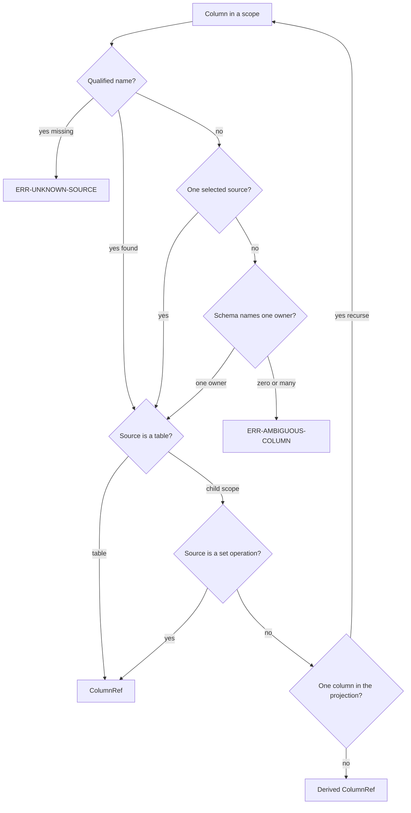

# Scope and resolution

Date: 2026-10-28 (Asia/Hong Kong).

This file is the only column-resolution algorithm. [DRY-1](01-principles.md#dry-1) points here. [GATE-6](04-parsing-and-dialects.md#gate-6) runs the algorithm before a `Query` exists.

## Scope walk

Use `sqlglot.optimizer.scope.traverse_scope(tree)`.

The walk yields one scope for each `SELECT`, in dependency order. CTEs and subqueries come before the query that reads them. The walk uses the tree you pass, so the nodes you find are the nodes you edit.

Databricks resolves a CTE before a persisted table. See [REF-DBX-NAMES](04-parsing-and-dialects.md#ref-dbx-names). The scope walk does the same. The library does not call a catalog. See [FP-5](01-principles.md#fp-5).

Read set-operation branches from `scope.set_operation_scopes`. See [PIN-UNION](04-parsing-and-dialects.md#pin-union).

For each scope the library uses:

- `sources`: alias to a physical table or to a child scope
- `selected_sources`: sources in the `FROM` and `JOIN` of this `SELECT`
- `columns`: column references that belong to this scope
- `is_cte`, `is_root`, `is_set_operation`

`_resolve_all` skips a scope whose expression is a set operation. Those columns belong to the branches.

## Scope names

| Condition | Name |
| --- | --- |
| Root scope | `root` |
| CTE | `cte:` plus the CTE alias |
| Subquery with an alias | `subquery:` plus the alias |
| Subquery with no alias | `subquery:#` plus the index |

`Query.cte("paid")` addresses `cte:paid`. An unknown name raises [ERR-UNKNOWN-SCOPE](09-error-catalog.md#err-unknown-scope). The hint lists the known CTE names.

## ColumnRef

| Field | Meaning |
| --- | --- |
| `table` | Physical table name, or null for a derived value |
| `name` | Column name at this hop |
| `via` | Hop list. CTE aliases, then subquery marks |

The prose name of `via` is hop list. See [TERM-HOP](02-glossary.md#term-hop).

A derived reference has `table is None`. A rename that asks for a physical table does not touch it.

## Resolution

The input is column `c` in scope `s`, plus the hop list so far. The hop list starts empty.

### RES-1

If the column names a table (`p.cust_id`), find `s.sources[c.table]`.

A missing source raises [ERR-UNKNOWN-SOURCE](09-error-catalog.md#err-unknown-source). The message includes the column text and the missing alias.

### RES-2

If the column names no table and `s` has one selected source, use that source.

### RES-3

If several selected sources exist, use the schema argument.

An owner is a physical table whose schema list contains `c.name`. One owner wins. Zero owners or several owners raise [ERR-AMBIGUOUS-COLUMN](09-error-catalog.md#err-ambiguous-column).

The hint tells the caller to qualify the column or to pass `schema`. The library does not guess. See [FP-4](01-principles.md#fp-4) and [KEEP-06](01-principles.md#keep-06).

The schema key is the same string `tables()` returns. The library does not fold case a second time. Postgres folding and Databricks identifier rules stay inside SQLGlot. See [REF-PG-LEX](04-parsing-and-dialects.md#ref-pg-lex) and [REF-DBX-IDENT](04-parsing-and-dialects.md#ref-dbx-ident).

### RES-4

If the source is a physical table, return `ColumnRef`.

`table` is the dotted name from catalog, schema, and table. Skip empty parts. `name` is the column name. The hop list is the list so far.

### RES-5

If the source is a CTE or a derived table, find the projection.

The match is the select item whose `alias_or_name` equals the column name. Append the CTE alias, or the mark `subquery`, to the hop list.

If that projection contains one column, resolve that inner column in the child scope. The result keeps the longer hop list.

If the projection is an expression, such as `SUM(amount)`, return a derived `ColumnRef`. `table` is null. `name` is the output name. The hop list includes the new hop.

If the child `SELECT` has `*` and no matching named item, return a derived `ColumnRef`. Do not walk into the star. `table` is null. v1 does not expand `*`.

If nothing produces the name, raise [ERR-UNKNOWN-COLUMN](09-error-catalog.md#err-unknown-column).

### RES-6

If the source is a set operation, resolve the column in every branch.

`UNION`, `INTERSECT`, and `EXCEPT` use this step. One distinct `ColumnRef` is the result. Several distinct results become one derived `ColumnRef`.

A recursive CTE parses and resolves. The self-reference resolves to the anchor branch. The library refuses a transform that changes a recursive CTE projection. See [XFM-REC](07-transforms.md#xfm-rec).

## Examples

`p.cust_id` in the outer query of [SAMPLE-2](03-library-architecture.md#sample-2) resolves to table `sales.orders`, name `cust_id`, hop list `("paid",)`.

The filter on `p.cust_id` in the root scope reports the physical table `sales.orders`. The hop list records the CTE.

An unqualified `cust_id` in `SELECT cust_id FROM sales.orders` uses [RES-2](05-scope-and-resolution.md#res-2). The table is `sales.orders`.

`SELECT a FROM t1 JOIN t2 ON t1.id = t2.id` raises [ERR-AMBIGUOUS-COLUMN](09-error-catalog.md#err-ambiguous-column) unless `schema` names one owner for `a`.
