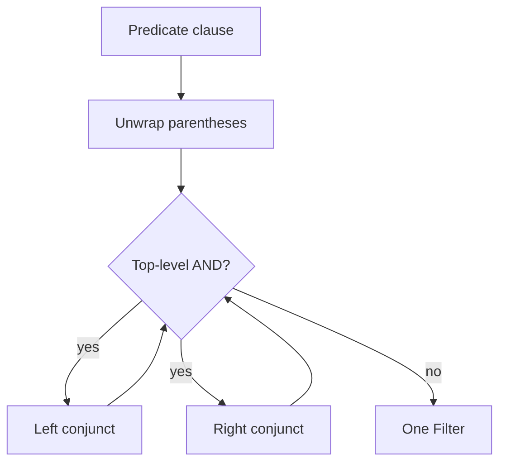

# Inspection

Date: 2026-10-28 (Asia/Hong Kong).

Inspection returns typed values. A `Filter` remembers its node, so a transform can take that value back. See [TERM-HANDLE](02-glossary.md#term-handle).

Reads do not copy the tree. They do not change it.

## INS-TABLES

`tables()` returns physical table names only.

The order is the scope-walk order. The first sight of a name wins. The library drops later sights. The library excludes CTE names.

A naive search for every table node reports a CTE name as a table. That result is wrong. Guards that ask which tables a query touches must use `tables()`.

On [SAMPLE-2](03-library-architecture.md#sample-2), `tables()` is `["sales.orders", "sales.customers"]`.

## INS-CTES

`ctes()` returns CTE names in definition order.

On [SAMPLE-2](03-library-architecture.md#sample-2), `ctes()` is `["paid"]`.

## INS-COLUMNS

`columns()` returns `ColumnRef` values with usage tags.

| Tag | The column appears in |
| --- | --- |
| `projection` | the `SELECT` list |
| `filter` | `WHERE`, `HAVING`, or `QUALIFY` |
| `join` | a `JOIN` condition |
| `group` | `GROUP BY` |
| `order` | `ORDER BY` |

One column can carry more than one tag. The tags are a set. The resolver is still [DRY-1](01-principles.md#dry-1).

## INS-PARAMS

`params()` returns bind markers in encounter order.

Each item is `{"param": name}`. A positional marker uses the digits, such as `"1"` for `$1`. A named marker uses the name, such as `"b"` for `%(b)s`. The library keeps each occurrence.

`SELECT a FROM t WHERE a = $1 AND b = %(b)s` yields `[{"param": "1"}, {"param": "b"}]`.

Filter values use that same shape. See [FLT-VALUE](06-inspection.md#flt-value).

## FLT-1

`filters()` walks every scope and every predicate clause.

The clauses are `where`, `having`, `qualify`, and each join `on`. Each clause splits into top-level conjuncts.

The split is recursive. It unwraps parentheses at every level. Do not call `And.flatten()`. See [PIN-AND](04-parsing-and-dialects.md#pin-and) and [DRY-4](01-principles.md#dry-4).

```python
def _conjuncts(e):
    e = e.unnest()
    if isinstance(e, exp.And):
        yield from _conjuncts(e.left)
        yield from _conjuncts(e.right)
    else:
        yield e
```



An `OR` group does not split. See [FLT-2](06-inspection.md#flt-2).

## FLT-2

An `OR` group is one `Filter`. `op` is `or`.

Splitting the group would let a caller remove one branch and widen the result in silence. `remove_filter` on a conjunct inside the group raises [ERR-UNSUPPORTED-REMOVE](09-error-catalog.md#err-unsupported-remove).

The caller removes the whole group, or replaces the whole group. See [XFM-REMOVE](07-transforms.md#xfm-remove).

On [SAMPLE-2](03-library-architecture.md#sample-2) the root `WHERE` contains one `OR` filter for the `BETWEEN` and `>` pair. The `IS NOT NULL` conjunct is a separate filter.

## FLT-3

`Filter` fields:

| Field | Meaning |
| --- | --- |
| `scope` | `root`, `cte:<name>`, or `subquery:<name>` |
| `clause` | `where`, `having`, `qualify`, or `join_on` |
| `op` | Operator token below, or `expr` |
| `columns` | Resolved `ColumnRef` values |
| `values` | Python values, bind objects, or expression objects |
| `negated` | True when the conjunct is `NOT (...)` |
| `sql` | The conjunct printed in the query dialect |
| `node` | Private syntax node. Not part of `to_dicts` |

Operators: `=`, `!=`, `>`, `>=`, `<`, `<=`, `in`, `between`, `is`, `like`, `ilike`, `or`, `expr`.

`FilterSet` is a tuple. `where(column=, table=, scope=, clause=, op=)` returns another `FilterSet`. Omitted arguments do not constrain.

`to_dicts()` is the frozen JSON shape. See [DEC-5](01-principles.md#dec-5).

```json
{
  "scope": "cte:paid",
  "clause": "where",
  "op": "=",
  "negated": false,
  "columns": [
    {"table": "sales.orders", "name": "status", "via": []}
  ],
  "values": ["paid"],
  "sql": "o.status = 'paid'"
}
```

The field `via` stores the hop list. A reference through `paid` stores `["paid"]`.

The prototype stored `"sales.orders.status"` strings and dropped the hop list. v1 uses the object form so the hop list survives.

## FLT-VALUE

| Node | Value |
| --- | --- |
| Literal | `Literal.to_py()` |
| Bind marker | `{"param": name or "?"}` |
| `NULL` | `null` |
| Boolean | the boolean |
| Anything else | `{"expr": sql}` |

Comparisons, `LIKE`, `ILIKE`, and `IS` store one value from the right side. `IN` stores one value for each member. `BETWEEN` stores `(low, high)`.

`NOT` around a conjunct sets `negated` and does not change `op`.

Columns inside a nested `SELECT` that is not this scope are not columns of this filter. The collection keeps columns whose nearest `SELECT` is this scope.

## Counts on SAMPLE-2

`filters()` returns seven filters.

| Check | Result |
| --- | --- |
| `status` | scope `cte:paid`, op `=`, value `paid`, table `sales.orders` |
| Root `IS` | table `sales.orders`, hop list `paid` |
| `IN` | values `EU` and `US` |
| `OR` | clause `where` |
| `HAVING` | value `100` |
| Customer `=` | clause `join_on`, table `sales.customers` |

A Databricks query `SELECT id FROM s.t QUALIFY ROW_NUMBER() OVER (PARTITION BY id ORDER BY ts) = 1` yields one filter. `clause` is `qualify`.
