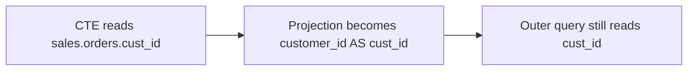

# Transforms

Date: 2026-10-28 (Asia/Hong Kong).

Transforms are the only way to change a tree. They are copy-on-write. See [FP-3](01-principles.md#fp-3).

## XFM-1

Every transform follows the same contract.

1. Copy the tree with `tree.copy()`.
2. Resolve on the copy. Edit the copy. The caller `Query` stays unchanged.
3. Record the operation name on the copy.
4. Return a new `Query`.

A search transform records a hit count. `rename_column` is a search transform. Zero hits do not raise inside the transform. Preview blocks with `NO_MATCH`. See [PRV-BLOCK](08-preview-apply-audit.md#prv-block).

A structural transform raises on a bad target. It does not use `NO_MATCH`. `and_where`, `remove_filter`, and `replace_filter` are structural.

Chained calls return a new `Query` each time. `q.preview(lambda t: t.rename_column(...).and_where(...))` is one preview. The operation list holds both names.

## XFM-PATH

A `Filter` points at a node in the original tree.

To edit the matching node in the copy, record the path from the root as `(arg_key, index)` pairs. Follow that path on the copy. `copy()` keeps the structure, so the path stays valid.

When the edit removes a conjunct, climb out of `Paren` wrappers first. See [PIN-PAREN](04-parsing-and-dialects.md#pin-paren).

If the parent is `And`, replace the `And` with the other child. If the parent is `Where`, `Having`, or `Qualify`, remove that clause node. Any other parent raises [ERR-UNSUPPORTED-REMOVE](09-error-catalog.md#err-unsupported-remove).

## XFM-RENAME

```python
query.rename_column(old: str, new: str, *, table: str, keep_output_names: bool = True) -> Query
```

The method renames each column node whose `ColumnRef` matches `table` and `old` and whose hop list is empty.

A reference through a CTE has a non-empty hop list. That reference stays. The CTE still exposes the old output name. See [TERM-OUT](02-glossary.md#term-out).

When `keep_output_names` is true, a bare projection becomes `new AS old`. Dashboards and downstream CTEs keep the old output name.

```sql
-- before
WITH x AS (
  SELECT cust_id FROM sales.orders WHERE cust_id > 0
)
SELECT cust_id FROM x

-- after rename_column("cust_id", "customer_id", table="sales.orders")
WITH x AS (
  SELECT customer_id AS cust_id FROM sales.orders WHERE customer_id > 0
)
SELECT cust_id FROM x
```



`keep_output_names=False` also renames the projection and every downstream reference that hops through it. `semantic_diff.projection_changed` is true. See [PRV-SEM](08-preview-apply-audit.md#prv-sem).

Comments stay. Literals stay. A comment that contains `cust_id` is still that comment. See [FP-7](01-principles.md#fp-7) and [TEST-RENAME](13-verification-and-traceability.md#test-rename).

Zero matches set hits to 0. Preview then blocks. A silent no-op rename is worse than an error.

`rename_column` must not change `tables()`. If it does, preview adds `TABLE_SET_CHANGED`. See [PRV-BLOCK](08-preview-apply-audit.md#prv-block).

## XFM-WHERE

```python
query.and_where(predicate: str | Expression, *, scope: str = "root") -> Query
```

The method finds the `SELECT` for `scope` and calls `where(pred, append=True, copy=False)` on that select.

The library parses a string with `sqlglot.condition` in the query dialect. The library trusts that string. User input uses `col(...).eq(param(...))`. See [API-SELECT](03-library-architecture.md#api-select) and [FP-6](01-principles.md#fp-6).

An unknown scope raises [ERR-UNKNOWN-SCOPE](09-error-catalog.md#err-unknown-scope). A scope that is not a `SELECT`, such as a bare `UNION`, raises [ERR-UNSUPPORTED-NODE](09-error-catalog.md#err-unsupported-node).

`and_where` must not change `tables()`.

## XFM-REMOVE

```python
query.remove_filter(f: Filter) -> Query
```

The method uses [XFM-PATH](07-transforms.md#xfm-path). The original `Query` still contains `f`.

A conjunct inside an `OR` group raises [ERR-UNSUPPORTED-REMOVE](09-error-catalog.md#err-unsupported-remove). The hint says to remove the whole group or to call `replace_filter`. See [FLT-2](06-inspection.md#flt-2).

## XFM-REPLACE

```python
query.replace_filter(f: Filter, predicate: str | Expression) -> Query
```

The method follows the same path as `remove_filter` and replaces the conjunct with the new predicate.

A conjunct inside an `OR` group raises [ERR-UNSUPPORTED-REMOVE](09-error-catalog.md#err-unsupported-remove). Replacing the whole `OR` filter is legal. The new predicate is one conjunct.

`replace_filter` must not change `tables()`.

## XFM-CTE

`query.cte(name)` returns a `Query` whose later verbs apply inside `cte:<name>`.

The return value is a whole `Query`, not a private subtype. See [SOL-L](01-principles.md#sol-l). An unknown name raises [ERR-UNKNOWN-SCOPE](09-error-catalog.md#err-unknown-scope).

| Verb | Behavior |
| --- | --- |
| `with_cte(name, query)` | Adds a CTE of the same dialect. A duplicate name raises [ERR-DUPLICATE-CTE](09-error-catalog.md#err-duplicate-cte). |
| `rename_cte(old, new)` | Renames the definition and every reference. Unknown `old` raises [ERR-UNKNOWN-SCOPE](09-error-catalog.md#err-unknown-scope). Duplicate `new` raises [ERR-DUPLICATE-CTE](09-error-catalog.md#err-duplicate-cte). |
| `drop_cte(name)` | Removes an unreferenced CTE. A remaining reference raises [ERR-CTE-IN-USE](09-error-catalog.md#err-cte-in-use). |
| `inline_cte(name)` | Fast-follow. A call raises [ERR-NOT-IN-V1](09-error-catalog.md#err-not-in-v1). |

`with_cte` and `drop_cte` can change `tables()`. They do not raise `TABLE_SET_CHANGED` for that change. The semantic diff still shows the table lists. See [PRV-SEM](08-preview-apply-audit.md#prv-sem).

CTE projection names are the CTE interface. An edit inside the CTE keeps those names unless the caller set `keep_output_names=False`.

## XFM-REC

A recursive CTE parses and resolves. See [RES-6](05-scope-and-resolution.md#res-6).

v1 refuses an edit that changes a recursive CTE projection. The error is [ERR-RECURSIVE-PROJECTION](09-error-catalog.md#err-recursive-projection).

A `WHERE` edit that does not change the projection is legal. `rename_column` on a projection inside the recursive CTE is not legal in v1, even when `keep_output_names` is true.

## XFM-SET-PARAMS

```python
query.set_params(patches: list[dict]) -> Query
```

This verb is Lane A. The screen and the HTTP example use it. See [LANE-A](10-product-ir.md#lane-a).

Each patch is `{"node_id": str, "value": ...}` or the richer forms in [IR-PATCH](10-product-ir.md#ir-patch). The method copies the tree and replaces the right-hand value only.

A patch that names a column, an operator, or a structure node raises [ERR-STRUCTURE-PATCH](09-error-catalog.md#err-structure-patch). An unknown node id raises [ERR-UNKNOWN-NODE](09-error-catalog.md#err-unknown-node).

`set_params` does not apply by itself. The caller previews the result. See [PRV-1](08-preview-apply-audit.md#prv-1).
