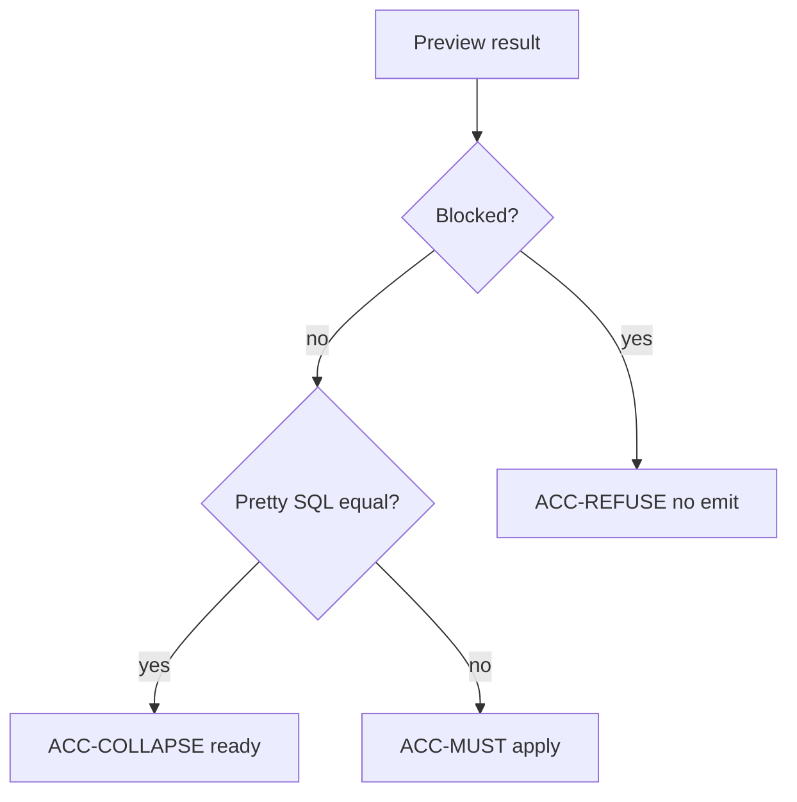

# Preview, apply, and audit

Date: 2026-10-28 (Asia/Hong Kong).

Preview is the gate between a transform and a commit. The accept matrix in this file is the only one. See [DRY-3](01-principles.md#dry-3).

## PRV-1

```python
query.preview(fn: Callable[[Query], Query] | None = None) -> Preview
```

`preview(fn)` calls `fn` and compares the original `Query` with the result. `preview()` with no function compares the query with itself.

`Preview` computes its fields at creation. Agents and people see the same evidence.

| Field | Content |
| --- | --- |
| `before_sql` | Pretty SQL of the original, in the parse dialect |
| `after_sql` | Pretty SQL of the result, in the parse dialect |
| `ast_diff` | SQLGlot edit script: insert, remove, move, update |
| `semantic_diff` | [PRV-SEM](08-preview-apply-audit.md#prv-sem) |
| `blocked_reasons` | [PRV-BLOCK](08-preview-apply-audit.md#prv-block) |
| `collapsed` | True when the pretty SQL texts are equal |
| `fingerprint` | Fingerprint of the after SQL, canonical form |
| `ops` | Operation names recorded by the transforms |

`blocked` is true when `blocked_reasons` is non-empty.

Pretty SQL is for display. The fingerprint hashes canonical SQL (`pretty=False`). See [API-TO-SQL](03-library-architecture.md#api-to-sql).

## PRV-SEM

`semantic_diff` holds:

| Key | Value |
| --- | --- |
| `tables` | `(before.tables(), after.tables())` |
| `filters_added` | Sorted `(scope, clause, sql)` triples in after but not before |
| `filters_removed` | Sorted triples in before but not after |
| `joins_changed` | True when the join shape differs |
| `projection_changed` | True when output names differ |
| `limit_changed` | True when `LIMIT` differs. The screen treats this as a cardinality change |

Filter triples use the printed conjunct. They do not use the private node.

The prototype stored tables and filter triples only. v1 also stores joins, projection, and limit, because the parent page requires those notes.

## PRV-BLOCK

Blocked reasons are strings. Apply turns them into [ERR-BLOCKED](09-error-catalog.md#err-blocked).

| Reason | When |
| --- | --- |
| `NO_MATCH` | A search transform recorded zero hits |
| `REPARSE_FAILED` | [PRV-REPARSE](08-preview-apply-audit.md#prv-reparse) raised |
| `TABLE_SET_CHANGED` | A transform that must keep tables changed `tables()` |
| `DISALLOWED_STATEMENT` | Agent mode and the result is outside `SELECT` and `WITH` |
| `MIGRATE_STUB` | [API-MIGRATE](03-library-architecture.md#api-migrate) |

`rename_column`, `and_where`, `remove_filter`, `replace_filter`, and `set_params` keep the table set. `with_cte` and `drop_cte` can change it.

A rename that matches nothing is `NO_MATCH`, not Collapse. Collapse is only an explicit no-op. See [ACC-COLLAPSE](08-preview-apply-audit.md#acc-collapse).

## PRV-REPARSE

Preview parses `after_sql` with `Query.parse` in the same dialect and the same schema argument.

That call runs [GATE-1](04-parsing-and-dialects.md#gate-1) through [GATE-7](04-parsing-and-dialects.md#gate-7). A raise becomes `REPARSE_FAILED` plus the error code. The preview does not raise yet. Apply raises.

This second parse is required because the SQLGlot parser is lenient. See [PIN-LENIENT](04-parsing-and-dialects.md#pin-lenient).

## PRV-APPLY

```python
preview.apply(actor: str = "unknown") -> Query
```

If `blocked` is true, apply raises [ERR-BLOCKED](09-error-catalog.md#err-blocked). The message lists the blocked reasons.

If `blocked` is false, apply returns a new `Query`. The original objects stay unchanged. Apply copies the after tree again.

Apply sets `preview.last_audit` and `query.audit` to the same [AUD-1](08-preview-apply-audit.md#aud-1) record.

A second `apply` on the same preview returns a `Query` with the same fingerprint. The commit is idempotent.

HTTP apply also checks the preview fingerprint. A mismatch is [ERR-STALE-FINGERPRINT](09-error-catalog.md#err-stale-fingerprint). That check lives in [HTTP-APPLY](11-fastapi-example.md#http-apply). The library method does not see HTTP headers.

## AUD-1

```json
{
  "before": "0123456789abcdef",
  "after": "fedcba9876543210",
  "ops": ["rename_column"],
  "actor": "builder",
  "collapsed": false,
  "semantic_delta": {}
}
```

`before` and `after` are fingerprints. `semantic_delta` is the semantic diff. `ops` is the operation list. The prototype omitted `ops`. The parent page requires it, so v1 stores it.

The actor is a person name or an agent id. It is not a secret.

## Accept matrix



### ACC-MUST

The caller named the dialect. Parse succeeded. The preview has no blocked reason. The pretty SQL changed.

Render and apply are both legal. The HTTP example applies only when the preview fingerprint still matches. See [HTTP-APPLY](11-fastapi-example.md#http-apply).

For Lane A, the patch touches a parameter value only. A structure patch is [ACC-REFUSE](08-preview-apply-audit.md#acc-refuse).

### ACC-REFUSE

Refuse when any of these is true:

- The SQL is empty or the dialect is unknown
- Parse failed, or v1 does not accept the statement
- The preview lists a blocked reason
- The HTTP fingerprint does not match
- The patch changes structure, a column, or an operator
- The statement is `DELETE` or `UPDATE`

No emit. The last good draft stays. The error carries phase, code, and track id. See [ERR-BODY](09-error-catalog.md#err-body).

### ACC-COLLAPSE

The tree is valid and the pretty SQL did not change.

`preview(lambda t: t)` and `preview()` take this row. Copy-on-write still returns a new `Query`. `q is q3` is false. The SQL texts are equal.

The screen does not say modified. See [UX-ST-READY](12-html5-ux.md#ux-st-ready).

## Library rows and HTTP rows

The three rows above cover the library and the HTTP example. HTTP adds the fingerprint and the structure patch to [ACC-REFUSE](08-preview-apply-audit.md#acc-refuse). It does not add a fourth row.
