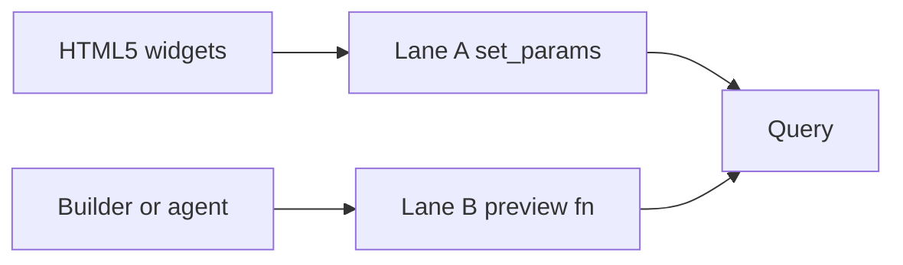

# Product IR

Date: 2026-10-28 (Asia/Hong Kong).

The product IR is the JSON document the screen reads. It is opaque. See [DEC-1](01-principles.md#dec-1). SQLGlot `Expression` stays private.

`schemaVersion` is the only version field. The value for this spike is `"0.1"`. An unknown version or an unknown `kind` fails closed with [ERR-PARSE-FAILED](09-error-catalog.md#err-parse-failed).

## IR-DOC

Top-level fields:

| Field | Meaning |
| --- | --- |
| `schemaVersion` | `"0.1"` |
| `dialect` | `postgres` or `databricks` |
| `rootId` | Id of the root node |
| `nodes` | Map from id to node |

`nodes` is flat. Children are id strings, not nested objects.

## IR-NODE

Every node has `kind`, `children`, and `editable`.

`children` is an array of strings. `editable` is a boolean.

An editable node can also carry `editMode`. In v1 the only mode is `param_value`.

Editable kinds are `Comparison`, `Between`, `InList`, and `Limit`.

Structure kinds include `Select`, `From`, `Join`, `Where`, `Group`, `Having`, and `Qualify`. Their `editable` value is false. The BI screen cannot change them. See [LANE-A](10-product-ir.md#lane-a).

A `Comparison` in v1 can change the right-hand value only. The left side and the operator stay structure. See [OPEN-6](01-principles.md#open-6).

## IR-IDS

Node ids are stable for the life of a draft.

The server assigns them at parse. A value patch does not renumber the other nodes. A structure transform from Lane B can issue a new draft and new ids.

The client sends ids back. It does not invent ids.

## IR-EXAMPLE

[SAMPLE-3](03-library-architecture.md#sample-3) projects to this shape. The snippet keeps the customer comparison only.

```json
{
  "schemaVersion": "0.1",
  "dialect": "postgres",
  "rootId": "n_select",
  "nodes": {
    "n_select": {"kind": "Select", "children": ["n_from", "n_where"], "editable": false},
    "n_from": {"kind": "From", "table": "sales.orders", "children": [], "editable": false},
    "n_where": {"kind": "Where", "children": ["n_cmp_cust_eq"], "editable": false},
    "n_cmp_cust_eq": {
      "kind": "Comparison",
      "editable": true,
      "editMode": "param_value",
      "children": [],
      "op": "=",
      "left": {"column": "cust_id"},
      "right": {"value": 42}
    }
  }
}
```

There is no separate parameter bag. The editable node holds the value. See the companion page.

## IR-PATCH

Lane A patches:

| `op` | `params` | Node kind |
| --- | --- | --- |
| `set_comparison` | `value` | `Comparison` |
| `set_between` | `low`, `high` | `Between` |
| `set_in_list` | `values` | `InList` |
| `set_limit` | `value` | `Limit` |

Any other `op` raises [ERR-STRUCTURE-PATCH](09-error-catalog.md#err-structure-patch).

A patch that sends `left`, `op`, `column`, or `children` raises the same code.

```json
{"op": "set_comparison", "nodeId": "n_cmp_cust_eq", "params": {"value": 99}}
```

`set_params` on the library takes `{"node_id", "value"}` and the richer forms above. See [XFM-SET-PARAMS](07-transforms.md#xfm-set-params).

A `Limit` patch sets `semantic_diff.limit_changed`. See [PRV-SEM](08-preview-apply-audit.md#prv-sem).

## LANE-A

Lane A is value patches on `editMode` `param_value`.

The BI screen and `PATCH /v1/queries/{draft_id}/params` use this lane only. See [HTTP-PARAMS](11-fastapi-example.md#http-params).

The server calls `set_params`, then the caller previews. The patch marks the draft dirty. Apply commits. See [PRV-APPLY](08-preview-apply-audit.md#prv-apply).

## LANE-B

Lane B is `preview(fn)` then apply.

Structure changes, renames, and CTE verbs use this lane. The BI form never sends a full tree.

`from_tree` and `apply_tree_patch` exist only inside the server harness. The client has no `from_json_tree`. See [KILL-13](01-principles.md#kill-13).



## IR-SECRETS

A password, a token, or a connection string never enters `nodes`. It never enters a log. See [API-AGENT](03-library-architecture.md#api-agent).
