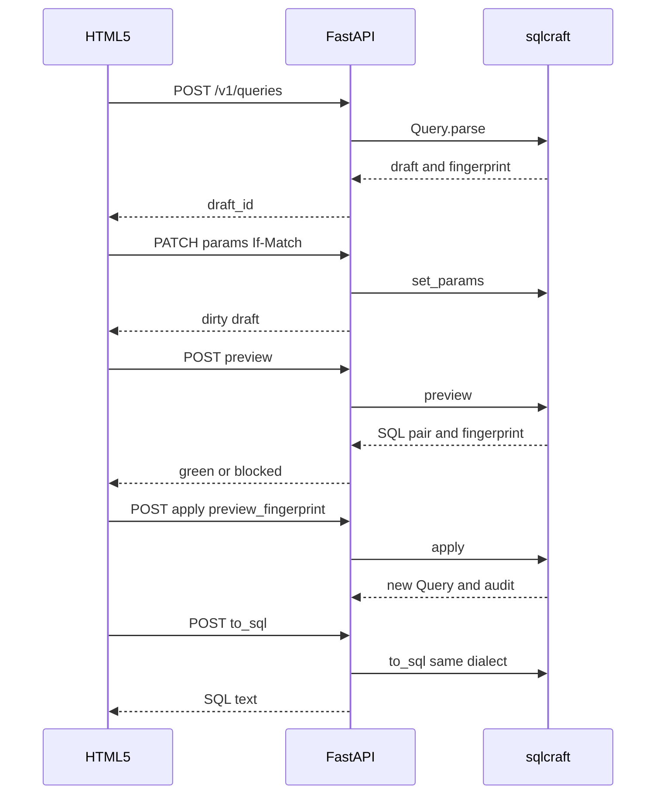

# FastAPI example

Date: 2026-10-28 (Asia/Hong Kong).

The example app is `examples/report-helper`. It is not part of the library package. See [KILL-11](01-principles.md#kill-11).

`sqlcraft` is the only SQL authority. FastAPI owns HTTP, JSON, drafts, and the fingerprint gate. HTML5 owns widgets. See [12-html5-ux.md](12-html5-ux.md).

## HTTP-APP

Mutating routes require a session and a CSRF token. A miss raises [ERR-CSRF](09-error-catalog.md#err-csrf).

`POST /v1/queries` accepts `SELECT` and `WITH` only. The call uses `Query.parse(..., mode="agent")`. See [API-AGENT](03-library-architecture.md#api-agent) and [GATE-5](04-parsing-and-dialects.md#gate-5).

Secrets never enter the tree, the form, or the logs.

Errors use [ERR-BODY](09-error-catalog.md#err-body). The screen keeps the last good draft.

## HTTP-CREATE

`POST /v1/queries`

```json
{"sql": "SELECT cust_id FROM sales.orders WHERE cust_id = 42", "dialect": "postgres"}
```

Response `201`:

```json
{"draft_id": "d_01", "dialect": "postgres", "fingerprint": "0123456789abcdef"}
```

The fingerprint is [TERM-FP](02-glossary.md#term-fp). A later patch sends it as `If-Match`.

## HTTP-TREE

`GET /v1/queries/{draft_id}/tree`

The body is the product IR. See [IR-DOC](10-product-ir.md#ir-doc). An unknown draft raises [ERR-DRAFT-NOT-FOUND](09-error-catalog.md#err-draft-not-found).

## HTTP-PARAMS

`PATCH /v1/queries/{draft_id}/params`

Header `If-Match` must equal the draft fingerprint. A miss raises [ERR-STALE-FINGERPRINT](09-error-catalog.md#err-stale-fingerprint).

The body is one [IR-PATCH](10-product-ir.md#ir-patch). The app calls `set_params`. A structure field raises [ERR-STRUCTURE-PATCH](09-error-catalog.md#err-structure-patch).

The patch marks the draft dirty. It does not commit. The response includes the new fingerprint.

## HTTP-PREVIEW

`POST /v1/queries/{draft_id}/preview`

Response:

```json
{
  "before_sql": "SELECT ...",
  "after_sql": "SELECT ...",
  "semantic_diff": {},
  "blocked": false,
  "blocked_reasons": [],
  "preview_fingerprint": "fedcba9876543210",
  "collapsed": false
}
```

Blocked reasons come from [PRV-BLOCK](08-preview-apply-audit.md#prv-block). `collapsed` true means [ACC-COLLAPSE](08-preview-apply-audit.md#acc-collapse). The screen must not say modified.

## HTTP-APPLY

`POST /v1/queries/{draft_id}/apply`

```json
{"preview_fingerprint": "fedcba9876543210"}
```

The fingerprint must match the latest preview. A miss raises [ERR-STALE-FINGERPRINT](09-error-catalog.md#err-stale-fingerprint). Apply stays off. See [ACC-REFUSE](08-preview-apply-audit.md#acc-refuse).

A match calls `preview.apply(actor=...)`. The response carries the new `draft_id` and the audit record. See [AUD-1](08-preview-apply-audit.md#aud-1).

A `DELETE` or an `UPDATE` never reaches this route. Create already refused it. See [TEST-BREAK-DML](13-verification-and-traceability.md#test-break-dml).

## HTTP-SQL

`POST /v1/queries/{draft_id}/to_sql`

The app calls `to_sql` with the draft dialect only. A different dialect raises [ERR-DIALECT-MISMATCH](09-error-catalog.md#err-dialect-mismatch) and the library raises [ERR-CROSS-DIALECT](09-error-catalog.md#err-cross-dialect) if the app forgets the check.

```json
{"sql": "SELECT cust_id FROM sales.orders WHERE cust_id = 99", "dialect": "postgres"}
```

## HTTP-PAGE

`GET /` returns the HTML5 page. `GET /healthz` returns `{"ok": true}`.

## HTTP-FLOW



Status map:

| Situation | Status | Code |
| --- | --- | --- |
| Created | 201 | none |
| Read or preview or SQL | 200 | none |
| Bad SQL or bad patch | 422 | catalog code |
| Stale fingerprint | 409 | `STALE_FINGERPRINT` |
| Unknown draft | 404 | `DRAFT_NOT_FOUND` |
| Missing CSRF | 403 | `CSRF_REQUIRED` |
