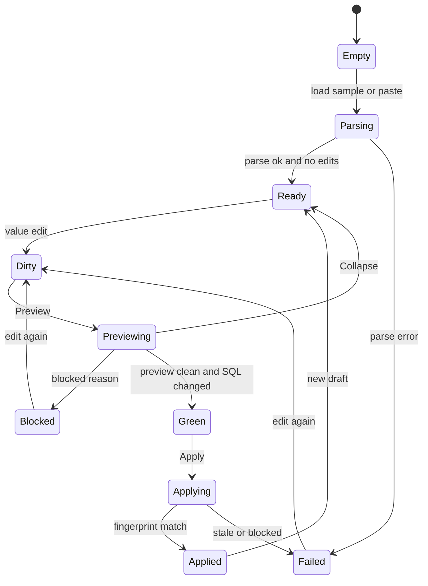

# HTML5 screen

Date: 2026-10-28 (Asia/Hong Kong).

The screen is one HTML document from `GET /`. It uses native controls. React is not required. See [KILL-15](01-principles.md#kill-15).

The screen edits Lane A values only. See [LANE-A](10-product-ir.md#lane-a). It does not paste a value into a SQL template. See [KILL-12](01-principles.md#kill-12).

The sample query is [SAMPLE-3](03-library-architecture.md#sample-3).

## UX-GOAL

A BI reader changes one filter value, reads the before SQL and the after SQL, and applies only after Preview shows a clean result.

Structure stays read-only. The dialect chip stays visible. Apply stays disabled until the preview fingerprint matches the dirty draft.

## UX-TYPE

Body text is 16px. Meta text is 14px. The title is 20px. The font is a system sans.

The space scale is 8px. Sections use 16px or 24px gaps.

Text on the page background has a contrast ratio of at least 4.5 to 1. The focus ring is 2px and visible on every control.

Blocked and ready states use words, not color alone. The words are `Blocked` and `Ready to apply`.

## UX-ORDER

Tab order is the filter fields, then Preview, then Apply. Apply is after Preview so the reader sees the SQL first.

Enter in a field runs Preview. Enter does not run Apply. Apply needs a click or an explicit second key.

After an error, focus moves to the error region. See [UX-ERROR](12-html5-ux.md#ux-error).

## Screen states



### UX-ST-EMPTY

No draft. The page shows one line: `Paste a SELECT on sales.orders, or load the sample.`

Preview and Apply are disabled.

### UX-ST-READY

The server loaded the tree and the pretty SQL did not change. See [ACC-COLLAPSE](08-preview-apply-audit.md#acc-collapse).

The status word is `Ready`. The page does not say modified.

### UX-ST-DIRTY

A value changed and preview is stale. Apply is disabled. The status word is `Unsaved value`.

### UX-ST-GREEN

Preview returned and `blocked` is false and `collapsed` is false. The status word is `Ready to apply`. Apply is enabled.

### UX-ST-BLOCKED

Preview listed a blocked reason. Apply stays disabled. The last good SQL stays on screen.

### UX-ST-APPLIED

Apply returned a new draft. The status word is `Applied`. The SQL panel shows the committed text.

### UX-ST-FAILED

The error region shows phase, code, track id, message, and hint. The form keeps the last good values.

## UX-ERROR

```text
Blocked
phase: apply
code: STALE_FINGERPRINT
track: a1b2c3d4e5f6
Preview expired. Preview again before apply.
```

No traceback. See [ERR-BODY](09-error-catalog.md#err-body).

## UX-STATUS

The Status control is a `select` in v1. The options are a static list: `paid`, `refunded`, `open`. See [OPEN-5](01-principles.md#open-5).

Customer id is a text field. The left column name and the operator are text, not inputs.

## UX-A11Y

The query tree is a nested list. Every control has a visible label: `Customer id`, `Status`, `Preview`, `Apply`.

The dialect chip is text in the header, not a control that changes the dialect. Emit uses the draft dialect. See [HTTP-SQL](11-fastapi-example.md#http-sql).

## UX-WF-01

Desktop, ready, [SAMPLE-3](03-library-architecture.md#sample-3).

```text
+------------------------------------------------------------------+
| Report helper                          Dialect: postgres         |
+------------------------------------------------------------------+
| Query tree                          | Filters                     |
| - SELECT cust_id, status, amount    | Customer id                 |
| - FROM sales.orders                 | [ 42                      ] |
| - WHERE                             | left: cust_id   (read-only) |
|   - cust_id = 42                    | op:   =         (read-only) |
|   - status = paid                   |                             |
|                                     | Status                      |
|                                     | [ paid              v ]     |
|                                     |                             |
|                                     | [ Preview ]  [ Apply ]      |
|                                     | Apply is disabled           |
+------------------------------------------------------------------+
| Status: Ready                                                    |
| Before                              | After                      |
| SELECT cust_id, status, amount      | (same until Preview)       |
| FROM sales.orders                   |                            |
| WHERE cust_id = 42                  |                            |
|   AND status = 'paid'               |                            |
+------------------------------------------------------------------+
```

## UX-WF-02

Narrow. The same regions stack. The dialect chip stays in the header.

```text
+-------------------------------+
| Report helper                 |
| Dialect: postgres             |
+-------------------------------+
| Query tree                    |
| - SELECT cust_id, status, ... |
| - FROM sales.orders           |
| - WHERE                       |
|   - cust_id = 42              |
+-------------------------------+
| Customer id                   |
| [ 42                        ] |
| Status                        |
| [ paid                    v ] |
| [ Preview ]                   |
| [ Apply ]                     |
+-------------------------------+
| Before                        |
| ...                           |
| After                         |
| ...                           |
+-------------------------------+
```

## UX-WF-03

Empty.

```text
+----------------------------------------------+
| Report helper              Dialect: —        |
+----------------------------------------------+
| Paste a SELECT on sales.orders,              |
| or load the sample.                          |
|                                              |
| [ Load sample ]                              |
|                                              |
| [ Preview ]  [ Apply ]                       |
| both disabled                                |
+----------------------------------------------+
```

The em dash in the wireframe is a placeholder glyph for "no dialect yet". The live chip says `postgres` or `databricks` after a successful parse. Before that, the chip says `none`.

## UX-WF-04

Blocked preview. The reader changed a value, preview ran, and the server refused.

```text
+------------------------------------------------------------------+
| Report helper                          Dialect: postgres         |
+------------------------------------------------------------------+
| Status: Blocked                                                  |
| phase: preview                                                   |
| code:  STALE_FINGERPRINT                                         |
| track: a1b2c3d4e5f6                                              |
| Preview expired. Preview again before apply.                     |
|                                                                  |
| [ Preview ]  [ Apply ]                                           |
| Apply stays disabled                                             |
+------------------------------------------------------------------+
| Before (last good)                  | After (not committed)      |
+------------------------------------------------------------------+
```

## UX-WF-05

Green preview, then the reader can apply.

```text
+------------------------------------------------------------------+
| Status: Ready to apply                 Dialect: postgres         |
+------------------------------------------------------------------+
| Customer id [ 99 ]     Status [ refunded v ]                    |
| [ Preview ]  [ Apply ]                                           |
| Apply is enabled                                                 |
+------------------------------------------------------------------+
| Before                              | After                      |
| WHERE cust_id = 42                  | WHERE cust_id = 99        |
|   AND status = 'paid'               |   AND status = 'refunded' |
+------------------------------------------------------------------+
```

## UX-WF-06

Dirty, preview not run yet.

```text
+------------------------------------------------------------------+
| Status: Unsaved value                  Dialect: databricks       |
+------------------------------------------------------------------+
| Customer id [ 99 ]                                               |
| left: cust_id (read-only)    op: = (read-only)                   |
|                                                                  |
| [ Preview ]  [ Apply ]                                           |
| Apply is disabled until Preview is green                         |
+------------------------------------------------------------------+
```

Databricks uses the same layout. The chip reads `databricks`. A `QUALIFY` node, when present, is a read-only tree row. The screen does not add `QUALIFY`. See [DIAL-DBX](04-parsing-and-dialects.md#dial-dbx).

## UX-KILL

The page does not embed SQL in a template. The page does not post a full `nodes` map. The page does not offer a dialect switch that calls `to_sql` for the other dialect. Cross-dialect work is [API-MIGRATE](03-library-architecture.md#api-migrate), and that method is a stub.
